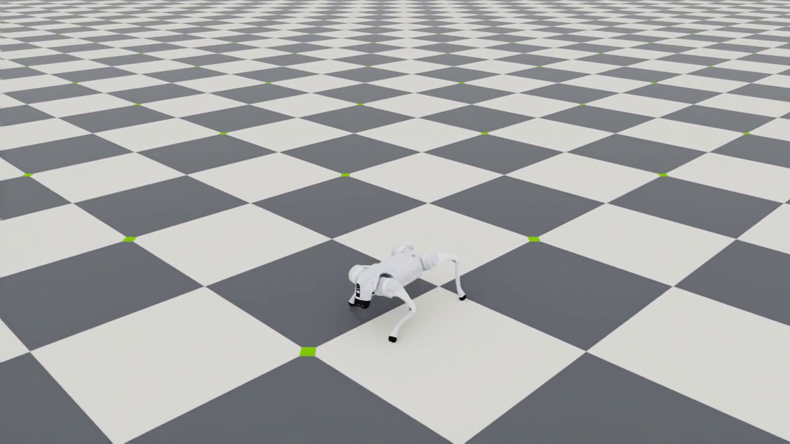

# RTX 5080 上的 HIM / Go2 平地 GPU 迁移

此入口复用本机已有的 Isaac Lab Docker 环境，使用 CUDA PhysX 仿真和原仓库的 HIMEstimator、HIMActorCritic、HIMPPO。旧版 Isaac Gym + PyTorch 1.10 不支持 RTX 5080 的 `sm_120`；原版软件栈、CPU 验收与 `original-cpu-baseline` 标签独立保留。

## 本机实际结果：标称平地通过

2026-10-10 完成 1024 环境、500 轮、51,200,000 个环境步，纯训练合计约 17.6 分钟。先训练 300 轮，再以 25% 纯转向指令恢复 200 轮。原始学习曲线见 [PNG](../reproduction/gpu-training.png) / [PDF](../reproduction/gpu-training.pdf)，第 300 轮的虚线标明采样变化。

`model_460.pt` 和 `model_480.pt` 都通过全部五个固定指令，选用前进误差较低的 `model_460.pt`。每项 64 环境、20 秒，均零跌倒、100% 首轮存活、100% 直立比例。它们是确定性标称状态验证；报告保留全部数值与零动作对照。

| 指令 | XY MAE (m/s) | Yaw MAE (rad/s) |
| --- | ---: | ---: |
| 前进 0.5 m/s | 0.1740 | 0.0765 |
| 后退 −0.5 m/s | 0.0268 | 0.0249 |
| 侧移 0.3 m/s | 0.0510 | 0.0348 |
| 原地转向 +0.5 rad/s | 0.0591 | 0.1279 |
| 原地转向 −0.5 rad/s | 0.0490 | 0.0576 |

前进实际平均约 0.337 m/s，仍有低速指令跟踪误差。第 500 轮前进 MAE=0.2030，超出原定 0.2 门槛，因此没有将最后一轮自动认定为最佳模型。初始 300 轮和最终 500 轮的未通过项也保留在报告中；没有调整验收阈值。

选用的本地 checkpoint：`isaaclab/logs/2026-10-10_19-02-23_flat-gpu-turn-resume/model_460.pt`。完整记录见 [gpu-flat-report.json](../reproduction/gpu-flat-report.json)。训练模型在本机日志中保留，Git 不包含这些 checkpoint；新克隆需要先训练。18 项 CPU 运行检查通过，驱动版本和核对文件哈希均保持原值。

最终模型的前进／转向视频分别保存在 `isaaclab/logs/2026-10-10_19-19-58_validated-forward-video/videos/` 和 `isaaclab/logs/2026-10-10_19-22-14_validated-turn-video/videos/`，均为 6 秒、50 fps、零重置。已检查行走连续帧，观察到脚步交替及机身移动；截图见下方。导出策略位于前进回放目录的 `policy.pt`，重新加载后与 CUDA 模型输出的最大绝对误差为 1.19e-7。



## 环境与位置

- 已有镜像：`local/isaaclab:3.0.0-ea-sim6.1.0`；Isaac Sim 6.1.0、Isaac Lab 3.0.0-EA。
- Python 3.12，PyTorch 2.11.0+cu128；支持本机 RTX 5080 Laptop。
- 默认使用 `$HOME/isaaclab/compose.yaml`，可通过 `LAB_ROOT` 更改。此仓库挂载为 `/workspace/himloco`。
- 训练模型、TensorBoard 与视频放在 `isaaclab/logs/<时间>_<run_name>/`，Git 忽略这些生成文件。
- `reproduction/gpu-environment.json` 记录实际环境，`gpu-requirements.txt` 仅记录包版本；它们不是完整的 Isaac Sim 安装器。新电脑需要先准备匹配的 Isaac Lab 环境与名为 `lab` 的 Compose 服务。

脚本不安装或修改 NVIDIA 驱动、系统 CUDA、Xorg、Vulkan 或 shell 初始化文件。仅启动已有容器、设置本进程参数并在用户目录保存数据。

## 训练、恢复与验收

在仓库根目录运行，首次平地训练：

```bash
bash isaaclab/run.sh train --num_envs 1024 --max_iterations 300 \
  --run_name flat-gpu-300 --viz none
```

100 步 / 环境 / 轮，300 轮为 30,720,000 个环境步。每 20 轮保存一次 checkpoint，文件名与已完成更新次数一致。`result.json` 的 `smoke_passed` 仅代表 CUDA 训练、数值与导出通过。

从本仓库中的 checkpoint 额外训练 200 轮（会输出 `model_500.pt`）：

```bash
bash isaaclab/run.sh train --checkpoint isaaclab/logs/<run>/model_300.pt \
  --num_envs 1024 --max_iterations 200 --turn_fraction 0.25 \
  --run_name flat-gpu-turn-resume --viz none
```

独立定量验收，默认每条指令 64 环境、20 秒，前 2 秒只从速度误差中排除：

```bash
bash isaaclab/run.sh evaluate --checkpoint isaaclab/logs/<run>/model_300.pt \
  --num_envs 64 --run_name flat-eval --viz none
```

默认指令为前进 0.5 m/s、后退 −0.5 m/s、侧移 0.3 m/s、原地转向 0.5 rad/s。可重复 `--command VX VY YAW` 选择指令。每条还从同一初始状态运行零动作对照。验收使用重置前终态，首个 episode 跌倒后不再采样，因此后续自动重置不会掩盖失败。

通过要求：样本数至少 64、时长至少 20 秒、XY 欧氏速度误差 MAE < 0.2 m/s、yaw MAE < 0.3 rad/s、首轮完整存活率 ≥ 95%，且物理状态有限、没有异常高度。默认四项都通过，suite 才标记 `passed`。报告保留各项结果与身体高度／姿态诊断。

这些验收取消噪声、推力、质量/COM随机与随机初始姿态，证明的是标称平地能力。确定性环境中的 64 个机器人不能当作 64 个独立扰动试验。验收结果不代表复杂地形、论文整体性能或 Go2 真机能力。

首批 300 轮使用 stock 指令分布，前进、后退和侧移通过，但原地转向未通过。追加训练使用 `--turn_fraction 0.25`，每次采样选取约 25% 环境，令 XY=0、保留均匀 yaw 指令，并关闭该环境的 heading/standing 覆盖，以补充纯转向样本。默认值 0 保留 stock 采样；此设置只影响训练，定量评价始终使用固定指令。

录制前进回放，视频保存在新 run 的 `videos/`；录制时省略 `--viz none`：

```bash
# 已在本机执行；新环境只需运行一次
bash isaaclab/setup-video.sh
bash isaaclab/run.sh play --checkpoint isaaclab/logs/<run>/model_300.pt \
  --num_envs 1 --command 0.5 0 0 --play_steps 500 \
  --video --video_length 500 --run_name flat-video
```

导出 `policy.pt` 包含 encoder 和 actor，输入 270 维（6×45，最新帧在前），输出 12 维关节位置偏移。保存后重新加载 TorchScript，与 CUDA 原模型对照；不会把活跃训练模型移出 GPU。这一输出的关节顺序、默认姿态与电机参数来自 Lab Go2 资产，不能直接用于真机。

## 与原版的差异

保留 HIM 的 3 维速度估计、16 维归一化 latent、prototype / Sinkhorn swap loss、PPO 与 6 帧历史。每帧顺序为 commands、angular velocity、gravity、joint position、joint velocity、last action。critic 追加真实线速度，平地总计 48 维；`next_critic_obs[:, 3:48]` 保持原版含义。

使用 Lab 自带 Go2 平地奖励、事件、USD 和电机设置（Kp=25、Kd=0.5，髋/大腿与小腿有不同力矩限制），与原版新增 Go2 的 Kp=20、URDF、Go1 奖励和域随机化不同。critic 使用无噪声观测。平地迁移完成不等于相同仿真条件下的论文复现；`--terrain rough` 尚需单独验收。

`vendor/` 从上游 `ef289ac` 复制，仅重命名包以避开容器内新 RSL-RL，并修复现代运行问题：std 保持正值、超时使用重置前下一状态 bootstrap、checkpoint 完成计数与 adaptive LR 恢复、loss 平均日志、安全加载与非有限值检查。详细来源见 `vendor/UPSTREAM.json`，原版 `rsl_rl/` 没有改动。

Isaac Sim 6.1 曾出现退出阶段挂起。结果完整保存后，入口用 30 秒 watchdog 结束本次 Python 进程；`--shutdown_timeout 0` 可禁用，不会终止容器或修改系统配置。
