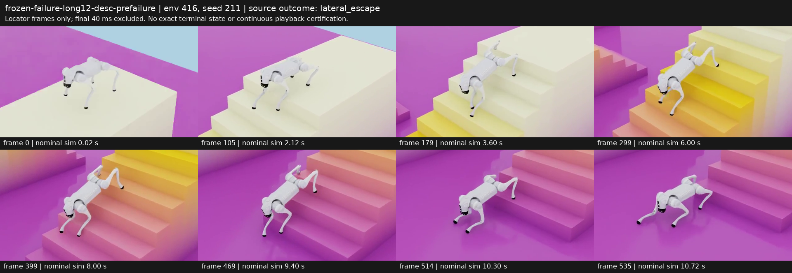
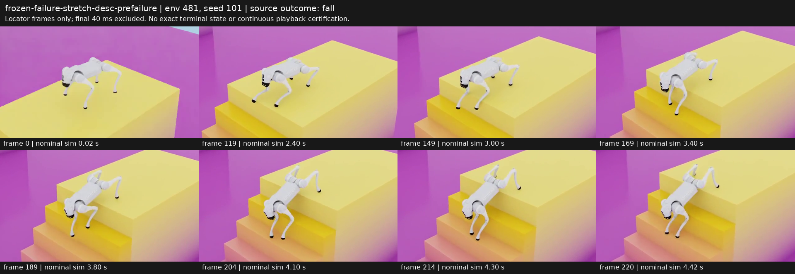
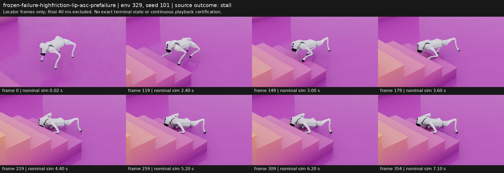

# 冻结主候选的失败前录像：完整保留帧序列独立审查

已按 page 升序、行优先、连续 frame 升序检查三个片段的全部 **1112 个保留帧、19 页**。这是 CPU 解码后的顺序图页检查，没有真正连续实时播放；`continuous_video_reviewed=false`。三段均为 control660 的已知失败环境重录，不能视为新的独立验收或用于重选模型。

裁片排除了首次终止的 rendered frame 及再前一帧，共 **40 ms**。因此这些是不完整的失败前片段，不能称完整 episode，不能声称看到了精确越界／碰撞终止瞬间。图页 320×180 缩略图与视角遮挡也限制了足端滑移和具体碰阶部位的判断。

| 片段 | 指定环境／种子 | 保留帧／图页 | 最后 nominal sim time | 原始首次失败时间／标记 | 所选环境 dense trace |
| --- | --- | --- | ---: | --- | --- |
| 12 级 17/25 cm 下楼，0.5 m/s | 416 / 211 | 536 / 9 | 10.72 s | 10.76 s / lateral escape | 有，完整 538 行；保留片段对应 536 行 |
| 23/20 cm 下楼，0.3 m/s | 481 / 101 | 221 / 4 | 4.42 s | 4.46 s / fall | **无** |
| 2.5 cm 突出边沿、高足端摩擦上楼，0.3 m/s | 329 / 101 | 355 / 6 | 7.10 s | 7.14 s / stall | **无** |

所有图页的 frame 范围／SHA、片段 CPU decode 与传感器字段核验见 [材料核验](frozen-failure-video-materials-verification.md)。本审查 ledger 及原录像与冻结结果逐值对照保存在 [独立审查 JSON](frozen-pre-failure-frame-sequence-review.json)。原始 MP4 和完整图页保留本机，Git 可只保存元数据、脚本、遥测和报告。

## 12 级下楼：持续运动仍会足端越界

9 页、frame 0–535 全部检查，保留 0.02–10.72 s。前两页接近首阶，约 2 s 前脚开始下降；3.62–8.40 s 持续沿梯段向下，没有可见长时间停住、完整翻倒或突然重置。8.42–10.72 s 进入底部过渡，前脚已经到下平台，而后脚仍处在末级台阶附近。机器人逐渐靠近楼梯一侧，末页仍在运动；录像没有四脚通过全梯到终点平台。

与同环境的完整 20 ms pre-reset trace 配对：root y 在 x≈1/2/3 m 时分别约 −0.0266/−0.1159/−0.2561 m，最后保留行达到 −0.4118 m。终止时 root y=−0.41329 m，仍在 ±0.65 m 内，但 RR_foot `[3.73848, −0.65233, −1.95572]` m 已超过足端横向界线。最后保留行 10.72 s 的 RR_foot y=−0.63942 m，随后 10.74/10.76 s 被视觉 guard 排除。**由终止 trace 确认 RR 足端越界，由录像观察失败前靠边过程；不能说末帧直接展示了阈值 crossing。**

终止行 10.76 s 的 RR_foot 当前／历史 contact 均 false，表示没有达到 >1 N 门控；其 foot-link world 水平速度为 2.44757 m/s，root world vy=−0.04448 m/s。RR_calf 的当前／历史法向范数也都为零。此前 10.62–10.72 s 足端同样无接触门控，但 RR_calf 当前承载从 63.39 降到 37.11 N；10.74 s 为 26.36 N，随后降为零。因此这个单例的终止边界更符合未足端承载的快速摆动／移动足端越界，**不能称 RR 接触点“滑出”**。传感器窗口不能证明每一物理子步均无载荷，也不能从这个 env 外推所有 123 个越界。原验收按足端位置判断，无论当前是否承载，该 env 仍保留 FAIL。

该片段保留区间的 FL_calf 当前法向向量范数峰值 342.74 N（2.16 s），FR_calf 当前峰 220.85 N（2.88 s）、历史峰 230.32 N（3.32 s）。RR_calf 当前峰 64.88 N（10.64 s）。RL_calf 的所有当前边界采样都是 0，但保留历史峰达到 81.00 N（3.38 s），这是历史／当前采样区别的实例；不能将当前为零写成该腿全程无碰阶。保留区间历史／当前 base 力均为零，`flight_paused` 为零；这些不消除已记录的足端越界失败。

航向范围约 −0.0641 至 +0.0233 rad，roll 约 −0.0507 至 +0.0845 rad。这些只是本单例保留区间的边界采样；小 yaw 未阻止 y 位移累积，也不能用小 roll 单独认证可靠性。更大样本的同场对照见 [冻结失败诊断](stair-frozen-failure-diagnosis.md)。

## 陡梯下楼：首阶下探前姿态，不含精确 fall 末态

4 页、frame 0–220 全部检查，保留 0.02–4.42 s。0.02–2.40 s 接近首阶；约 3 s 开始明显前脚下探，后脚仍留在较高起点平台。3.62–4.42 s 前身继续降低，身体处于跨首级边沿的姿态。末页没有显著横向冲出、完整翻滚或 reset，但这不是成功片段：原始首次 episode 在 4.46 s 标记 fall，终点 root `[1.19751,0.01576,−0.02674]` m，x 位于首个踏面 `[1,1.2)`。

冻结 evaluator 只录每个 case 的首个代表环境，case 15 为 env480；本录像选 env481，**所选环境没有 dense force／pose／action trace**。不能从 env480 的数据给 env481 指定 pitch 角度、base 碰撞力、calf 峰值或精确 fall 触发原因。图页能够提供前脚下探／后脚仍高的视觉证据，终点能够定位首次失败在首阶附近；精确碰撞机理仍未证成。其他环境的稀疏关联诊断见 [陡梯报告](stair-stretch-association-review.md)。

## 高摩擦带边沿上楼：首阶前长期无明显前进

6 页、frame 0–354 全部检查，保留 0.02–7.10 s。0.02–2.40 s 接近首阶；2.42–3.60 s 前腿试探首级，并呈现左右前脚放置不一致。3.62–4.80 s 前身继续压低；此后 4.82–7.10 s 在首阶前保持非常接近的身体／足端位置，只有小幅可见变化，没有完整越过首阶、翻倒或 reset。该视觉长期停滞与原始 7.14 s 的 stall 标记一致。

终点 root `[0.91902,−0.04810,0.23179]` m，尚未到首阶 x=1 m。FL_foot 终点 `[1.26999,0.13496,0.18369]` m，而 FR_foot `[0.95999,−0.19059,0.12663]` m；前脚未同时进入同一踏面。足端是 link 位置，不能由这些点精确识别真实接触点。

该视频是 16/33 cm、2.5 cm 边沿的上楼，basic 足端静／动摩擦 1.0/0.8。它选 env329，而 case 10 的 trace 代表环境为 env320，**env329 的 dense telemetry 不可用**。因此不能将可见低姿态直接量化为小腿 65–70 N 承载，不能断言前腿被边沿某个确定碰撞点卡住，也不能用本例证明单独的摩擦因果。

## 对照范围与保存边界

三段重录与其各自原冻结条件的所选环境相比较，保存的初始 root XYZ、terminal root XYZ、terminal 四足 XYZ、首次 episode 时长、completed/fall/stall/escape 标记均逐值完全一致。此核对不覆盖未保存的完整初始状态，也不能证明所有 GPU 隐藏状态或整条轨迹逐位一致。

这些失败与四段已审查的成功片段一起保存。仍保留完整最终矩阵 FAIL、失效环境及难场景；没有把局部成功、较低滑移代理或更短动作差分当作全面可靠性／平顺性证明。物理传感器 5 ms、策略 20 ms，历史年龄 0/5/10 ms 的采样窗口与 world-XY 足端速度代理限制继续适用。

可复查脚本：[失败裁片](clip-pre-failure-video.py)、[保留帧生成与核验](inspect-pre-failure-frames.py)。它们处理已有文件，保持成功片段 helper 的完成保护条件，也不启动仿真或修改显卡驱动。
