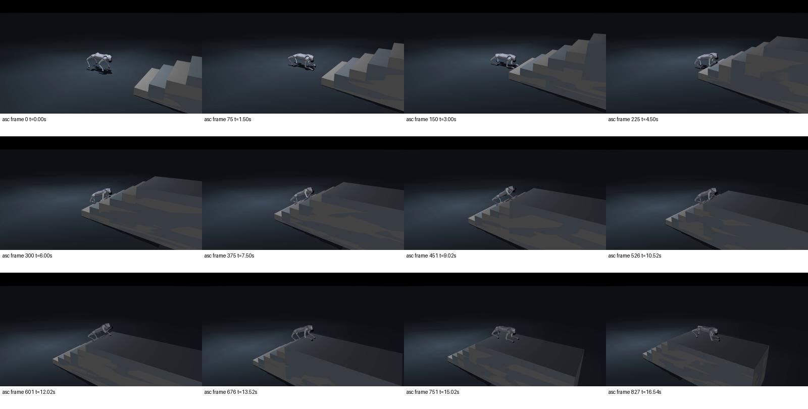
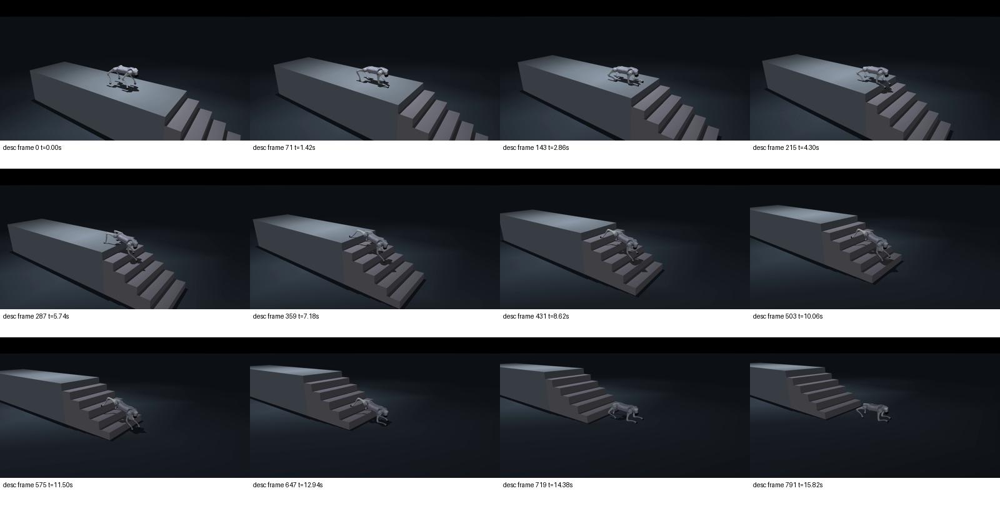

# 2026-10-14：MuJoCo sim2sim 与域随机化

主要自动验证于03:43结束，随后补充失败录像、航向及突出边沿复核。没有向实物发送控制指令。

MuJoCo 3.3.7 独立安装在 `/home/cone/robotics/envs/himloco-mujoco-py311`，Go2 官方模型在共享 assets 目录；Isaac Lab 继续使用既有容器。

冻结候选：**arm2 / 860**，`artifacts/go2-night3-selected/`；策略 SHA256 `d3be2fd053155ebc1384952ecdd1e79a63fe465c68c9b11378719dbc70ca08cd`。

候选先用 1400–1407 开发种子按标准楼梯完成率、全部域扰动完成率、受力小腿接触选定；以下 1800 起的种子不参与训练或候选选择。

| 策略 | 名义前进/楼梯 | 独立域扰动+多种楼梯 | 完整20秒八类运动 |
| --- | --- | --- | --- |
| baseline | 144/144 | 273/288 | 24/64 |
| selected | 144/144 | 287/288 | 24/64 |

训练保留原 HIM/HIMPPO、6×45 历史和原 actor 输入，地形扫描只供 critic。
Arm1：原奖励+robust 域，100 次更新。Arm2：原奖励+deployment 域、25% 多方向平地、探索标准差0.3，200次更新。Arm3：Arm1基础上 deployment 域+原有轻接触惩罚 -0.02，200次更新，是显式 Go2 奖励适配。

原模型已包含质量和重心变化。本次实际验证并训练足端材料、较大重心范围、独立 PD 增益，并新增每次重置的关节电机强度0.9–1.1、位置指令延迟0–10ms。物理参数初末读回、优化器/算法配置、所有候选及失败结果均保留。

MuJoCo 控制接口按名称映射关节，200Hz PD/50Hz策略，动作默认位置+0.25×输出，DC速度–扭矩曲线与训练一致。角速度从世界坐标转换到机身，避免误用惯性主轴局部坐标；随机惯性参数重算，状态时间同步。

通过的 MuJoCo 模型将 Menagerie 原关节阻尼2、摩擦损失0.2、armature0.01对齐到训练值0，保留橡胶足端接触与全部腿部碰撞。原策略在未对齐的默认模型下未通过；不能宣称任意 Go2 模型均可迁移。

楼梯成功需要四足越过最后踏步并直立、无机身接触保持0.5秒，不能靠自动重置或到中段算成功。含外部航向反馈，不能宣称为零航向指令结果。接触同时统计几何接触与>1N实际受力，不把完成率等同于丝滑步态。

| 最终候选测试场景 | 成功 | 受力小腿接触比例 | 小腿最大法向力N |
| --- | --- | --- | --- |
| flat-16x27-v0.3 | 24/24 | 22.3% | 64.8 |
| flat-16x27-v0.5 | 24/24 | 8.6% | 72.9 |
| asc-16x27-v0.3 | 24/24 | 19.0% | 188.8 |
| asc-16x27-v0.5 | 24/24 | 13.5% | 819.8 |
| desc-16x27-v0.3 | 24/24 | 45.5% | 210.8 |
| desc-16x27-v0.5 | 24/24 | 34.7% | 331.0 |
| asc-0.11x0.35-v03 | 24/24 | 11.5% | 288.0 |
| asc-0.17x0.25-v03 | 24/24 | 20.1% | 314.6 |
| asc-0.2x0.3-v03 | 24/24 | 22.9% | 347.2 |
| desc-0.11x0.35-v03 | 24/24 | 42.0% | 251.0 |
| desc-0.17x0.25-v03 | 24/24 | 42.9% | 314.1 |
| desc-0.2x0.3-v03 | 23/24 | 47.3% | 280.0 |

Isaac Lab 名义楼梯：两策略均1024/1024。deployment 域：原策略918/1024、新候选1018/1024，新候选通过预设门槛。完整平地检查均仅前进通过：原策略侧移存活0%、转向61.1%；新候选所有四类指令均存活，但后退、侧移和转向跟踪仍失败。统计摘要位于 `night3-final-isaac-*-result.json` 和对应 selected-result；完整逐环境/轨迹证据保留在对应 `isaaclab/logs/`，路径与SHA256见`night3-isaac-full-evidence-manifest.json`；程序退出成功与性能验收分开记录。

整机 GPU 峰值 13.42 GiB。五个驱动/图形配置基准文件哈希全部一致：True。

新候选在 MuJoCo 完整20秒八类运动中仅前进0.3/0.5m/s和站立通过（24/64），后退、侧移、转向未通过。取消楼梯外部航向反馈后91/96，原反馈条件96/96；1/2cm薄突出边沿、上下行补充检查32/32。不能省略反馈控制后沿用原成绩。

下午部署需依据真实 EDU 的关节顺序、IMU坐标、控制频率和减速比核对控制协议。先验证悬吊与低速平地；八类运动或楼梯域测试未通过的能力不应直接开放。sim2sim成功不能替代实物验证，也不能把残留受力小腿接触认定为已实现丝滑上下楼梯。

选择的模型以鲁棒完成率优先，并不是最少小腿碰撞的模型。标准下楼的>1N小腿接触比例达到约35–46%，成功样本中最大瞬时法向力819.8N。该值是MuJoCo单接触的仿真法向力，不是实物力测量；最坏样本已按相同种子和参数重录，仍成功且冲击约819.8N。最终结论是**可作为前进及楼梯sim2sim候选，仍有明显接触质量和多方向指令限制，不能认证为可直接开放的全方向真机策略**。

`artifacts/go2-night3-selected/result.json`记录完整arm2训练到960轮的运行信息；实际选定的是860轮检查点（追加100轮），由`model.pt`、导出校验及`night3-selection-frozen.json`的哈希明确绑定。最终参数读回来自相同训练run的末态，记录的是域分布而非860轮的逐环境参数。

Isaac Lab中的`torque_saturation_fraction`原实现比较computed/applied扭矩，加入电机强度后也会把强度缩放计入差值，因此deployment域该字段不能解释成真实硬饱和率。本次不据此选择或宣传电机安全裕量。

录像：
- flat：`/home/cone/robotics/logs/night3-selected-video-flat/video.mp4`
- asc：`/home/cone/robotics/logs/night3-selected-video-asc/video.mp4`
- desc：`/home/cone/robotics/logs/night3-selected-video-desc/video.mp4`

运行说明见 `sim2sim/README_zh.md`；完整结论与来源见 `night3-final-overview.json`。

- 失败：`/home/cone/robotics/logs/night3-selected-video-failed20cm-desc/video.mp4`
- 最大冲击：`/home/cone/robotics/logs/night3-selected-video-maximum-calf-impact/video.mp4`

五段录像均完整解码并核对帧数与轨迹一致；各12个均匀采样帧用于视觉检查，未宣称逐帧完成丝滑步态认证。

查看冻结候选（需本机图形终端）：

```bash
cd /home/cone/Research/HIMLoco
bash sim2sim/play-selected.sh --terrain asc --heading-feedback --viewer \
  --output /home/cone/robotics/logs/my-selected-stairs
```




