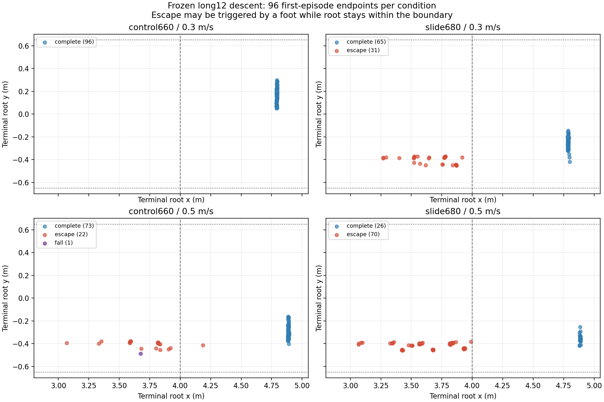
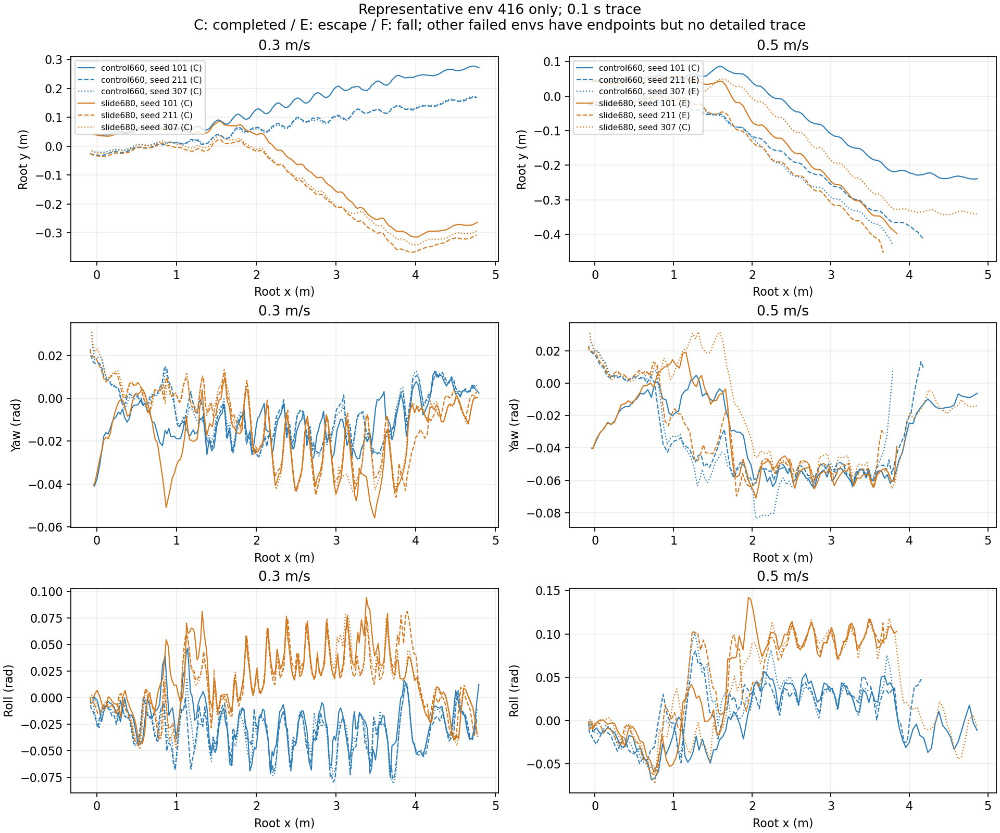

# 冻结策略的失败诊断：长梯横向误差与陡梯首阶问题

本诊断仅在 CPU 上读取原始冻结结果，没有重新运行仿真、修改运行源码、调整阈值、继续训练或重选 checkpoint。主候选仍为 control660；slide680 只是冻结前已经声明的对照。诊断不改变完整最终矩阵 FAIL，也不证明运动已达成“丝滑”。

## 相同长梯与速度下的两策略

两份原始结果分别来自 `2026-10-11_05-48-09_frozen-final-speed03` 和 `2026-10-11_05-52-29_frozen-final-speed05`。明确读取 `primary-result.json` 和 `candidates/0_model_680/result.json`，未把候选阶段的混合 `result.json` 当作主策略结果。文件 SHA256 记录在本诊断 JSON。

以下全部为 case 13：12 级下楼，17 cm 高、25 cm 深、1.2 m 宽、无突出边沿；首阶 x=1 m，下平台起点 x=4 m，目标 x=4.65 m。每种条件为初态种子 101/211/307 × 32 环境，共 96 个第一次 episode。对照在主候选的同一标称场景运行；每个速度下两策略的 96 个已保存初始 root XYZ 逐值完全一致。这只核对已保存位置，不能声称所有隐藏状态逐位相同。

| 策略／速度 | 三个种子的完成数 | 完成总数 | 横向越界 | 跌倒 | 停滞 | 机身接触环境 |
| --- | --- | ---: | ---: | ---: | ---: | ---: |
| control660 / 0.3 | 32、32、32 | 96/96 | 0 | 0 | 0 | 0 |
| slide680 / 0.3 | 20、20、25 | 65/96 | 31 | 0 | 0 | 0 |
| control660 / 0.5 | 27、21、25 | 73/96 | **22** | **1** | 0 | **1** |
| slide680 / 0.5 | 11、5、10 | 26/96 | 70 | 0 | 0 | 0 |

主候选 0.5 m/s 的 23 个未完成不能全部写成越界：seed 211 有 10 个越界及 1 个跌倒／机身接触。该跌倒为 env 439，终点 root `[3.6741, −0.4881, −1.6386]` m，测量时长 9.08 s；它没有越界标记。详细轨迹只录 env 416，故不能给出 env 439 碰撞发生的精确身体位置或连续过程。

这里使用 `final_acceptance.cases[].traversal_passed` 的 95% 完成、最多 5% 失败、零机身接触门槛。采集内部 `policy.thresholds.completion_fraction=0.9` 不是最终验收门槛。上述只有 control660 / 0.3 的长梯下楼三个种子全部通过；其余三个条件均未通过。

## 越界触发与航向纠偏的边界

原实现的越界条件是 root 横向位置超过 `width/2+0.05=0.65 m`，**或** x 位于 `[1,4] m` 梯段范围内的任意足端超过同一横向边界。逐个重算所有终点：31+22+70=123 个越界均由 **RR_foot** 触发，root 自身均仍在 ±0.65 m 内。因此只查看 root 轨迹会漏掉失败。

主候选 0.5 m/s 越界终点 root x 在 3.069–4.187 m、y 在 −0.456 至 −0.378 m；对照 0.3 m/s 的 x 在 3.269–3.917 m，对照 0.5 m/s 的 x 在 3.067–3.988 m。这些失败集中在梯段后部与下平台过渡附近，不能称已经完整走到终点再失败。

外部航向控制只请求 `yaw_rate=clamp(−yaw,−0.5,+0.5)`，`vy` 指令固定为零，**没有横向位置反馈项**。yaw 回到接近零不会自动消除已积累的 y 位移。策略仍使用速度、姿态、关节反馈；这里没有把它称为整个机器人开环。

每条件每种子只有 env 416 的 0.1 s 稀疏轨迹可供过程诊断。主候选 0.3 的 seed 101 在梯段范围内 root y 从约 0.062 增至 0.239 m，最后到 0.271 m，梯段内采样最大 |yaw| 只有 0.0283 rad。主候选 0.5 的 seed 211/307 则逐渐移向负 y，分别在 10.76/9.76 s 越界；其最后稀疏采样在 10.72/9.72 s。对照 0.5 的 seed 101/211 也呈负 y 累积，而 seed 307 的 env 416 完成。对照 0.3 三条代表轨迹均完成，但该条件整体只有 65/96；不能用代表成功替代全批次统计。

## 跟踪、动作变化和接触代理

下表是三个种子／场景报告指标的**算术均值**。每个原始指标在其种子内部按首次 episode 的有效样本聚合，排除前 1 s；其中跟踪／姿态／jerk 包含接近和终点平台阶段，并非只统计梯段。不同条件因提前失败导致采样时长不同，这不是全样本合并估计，也不是因果检验。

| 指标 | control .3 | slide .3 | control .5 | slide .5 |
| --- | ---: | ---: | ---: | ---: |
| body XY 跟踪 RMSE，m/s | 0.06891 | 0.07175 | 0.08526 | 0.10261 |
| body vx，m/s | 0.26312 | 0.26376 | 0.45360 | 0.43365 |
| body vy，m/s | +0.01336 | −0.01457 | −0.01959 | −0.03528 |
| 航向绝对误差，rad | 0.01250 | 0.01918 | 0.03585 | 0.03627 |
| yaw-rate 跟踪 MAE，rad/s | 0.03703 | 0.05126 | 0.05866 | 0.06115 |
| 横向绝对误差，m | 0.09685 | 0.13659 | 0.15325 | 0.16537 |
| roll RMS，rad | 0.03638 | 0.03793 | 0.03472 | 0.07404 |
| pitch RMS，rad | 0.28119 | 0.30340 | 0.33019 | 0.34103 |
| world 三维 jerk RMS，m/s³ | 60.100 | 64.300 | 84.454 | 88.433 |
| action 一阶差分 RMS | 0.14223 | 0.13839 | 0.20597 | 0.20703 |
| action 二阶差分 RMS | 0.07869 | 0.07569 | 0.12747 | 0.12379 |
| 当前接触足端 world-XY 速度，m/s | 0.17326 | 0.10447 | 0.18309 | 0.15240 |
| 当前足端滑移代理比例 | 0.27490 | 0.21539 | 0.26100 | 0.25469 |
| 当前大小腿接触环境步比例 | 0.40362 | 0.33171 | 0.42469 | 0.38728 |

0.5 m/s 对照的 roll RMS 约为主候选的 2.13 倍、body vy 绝对值约为 1.80 倍，同时越界明显增多。对照的足端速度／滑移代理下降，却没有提高完成率；主候选 .5 的 roll RMS 甚至略低于 .3，也不能保证可靠性。因此这组数据不支持用单一滑移、roll 或动作差分指标认证“平顺且能完整走完”。pitch 包含正常下楼俯仰，不能当作平地姿态偏差。

动作差分按 20 ms 的策略步长计算，未除以 dt，单位是无量纲的每步差分；jerk 由完整 20 ms world root 速度二次有限差分得到，除以 dt²，取三维范数 RMS。没有用 0.1 s 稀疏轨迹重算 jerk。

足端代理以同一策略边界当前法向力大于 1 N 门控，速度为 foot link 的 world-XY 速度，比例阈值为 0.1 m/s。它不是接触点沿局部表面的切向滑动。当前／历史大小腿接触计数（原字段 `shank_contact`，Go2 选取八个 thigh/calf body）只表示相应采样存在法向力，不能反推接触持续时长或碰阶位置。当前传感器 5 ms 更新、20 ms 策略边界，历史保留三样本／最老 10 ms，不能覆盖完整策略步的四个物理子步。

slide680 比 control660 多保存了 20 次续训更新，奖励和权重同时变化，只有一个训练随机种子；这次比较不能证明某项 reward 单独造成了横向失败。

## 陡梯的独立关联诊断

case 15 的 23/20 cm 下楼另见 [陡梯关联诊断](stair-stretch-association-review.md)，其中保留四种条件的 384 个终点和 12 条代表轨迹：标称 .3 为 54/96、34 跌倒、8 停滞；标称 .5 为 94/96、2 跌倒。标称 .3 的 34 个跌倒中 33 个 root 终点处于首个踏面 x∈[1,1.2) m。basic 标称 .3 的代表停滞记录表现为 root x≈1.843 m 长时间不动、FR calf 持续承载约 65–70 N，而 FR foot 当前无接触。这支持“小腿支撑／首阶碰撞与失败关联”的描述，不能从稀疏数据证明具体碰撞点或摩擦因果。

较低足端摩擦或较快速度提高了该陡梯组完成次数，却同时可能增加接触足端速度、滑移代理或 pitch；两类成对对照均有原本成功变成跌倒的个例。标称 none/basic 虽读回相同摩擦、初始 root XYZ、质量／惯量／COM／PD，仍为 54/96 对 58/96，不能声称严格单因素实验。该补充分析没有陡梯连续视频，也不用于替换最终验收。

## 可复查材料

- [生成脚本](stair-frozen-failure-diagnosis.py)：只读原始 JSON，验证终点越界触发、保存 JSON/CSV/两张图。
- [完整诊断 JSON](stair-frozen-failure-diagnosis.json)：四份原始文件 hash、逐种子指标、384 个终点、12 条代表轨迹、匹配范围与限制。
- [终点 CSV](stair-frozen-failure-diagnosis.csv)：保留每个首次失败及触发足端，不合并或删去难场景。
- [导出与冻结 hash 审计](frozen-policy-independent-audit.md)、[完整帧顺序审查](frozen-control660-complete-frame-sequence-review.md)：与本 CPU 诊断互补；真实连续视频播放仍未完成。

重生成：`python3 reproduction/stair-frozen-failure-diagnosis.py`。这条命令仅处理本地已有结果，不启动模拟器或 GPU。
