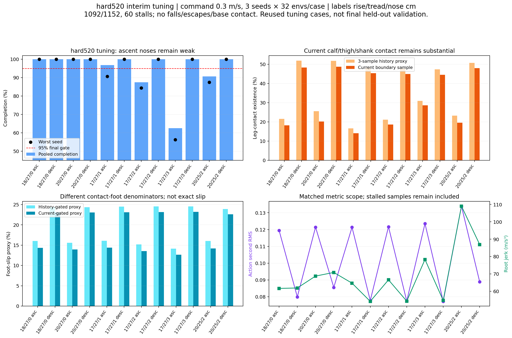
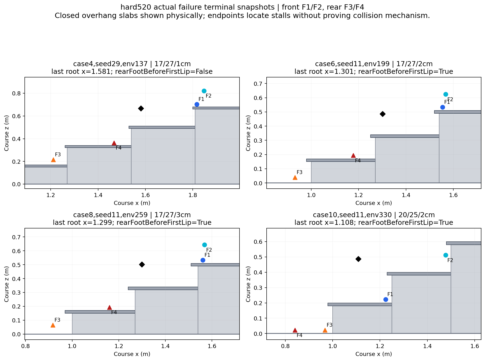

# Hard520 interim tuning analysis

**Target early and middle ascent transitions with nosing, alongside actual descent leg contact.** Hard520 completes **1092/1152** at command 0.3 m/s but does not pass either the original 90% per-case gate or final 95% gate. All 60 failures are stalls in four nosing-ascent cases. No-nosing 18/20 cm ascents and every descent case complete 96/96. This twelve-case matrix is reused for training decisions and is **interim tuning, not final held-out acceptance**.

Reset seeds 11/29/47 produce 361/365/366 completions out of 384. Falls, escapes, timeouts, nonfinite states, invalid physics, invalid starts and both legacy/current base-contact environments are zero. The weakest seed-case is 18/32 on 17 cm/27 cm-tread/3 cm-nose ascent. Fixed dynamics and randomized starting poses do not establish domain-randomized robustness. Actual foot material readbacks are recorded: static friction 0.8, dynamic 0.6, restitution 0, identical across all 384×4 feet and the old 192×4 case batch; configured ranges are fixed. Terrain material has no separate physical readback in these files. Reset seeds do not resample startup material/dynamics.

## Case results and current/history metrics

Geometry labels are rise/tread/nose in cm. Completion triple is seed 11/29/47. Contact and slip cells are **current boundary / three-sample history** percentages; metric means are arithmetic averages of the three seed-level aggregates, not pooled RMS. Current and history foot-slip denominators differ and are retained separately in JSON.

| Case geometry | Complete seeds | Complete total | Max pause s | Leg current/history % | Slip current/history % | Action second RMS | Root jerk m/s³ |
|---|---:|---:|---:|---:|---:|---:|---:|
| 0: 18/27/0 asc | 32/32/32 | 96/96 | 0.60 | 18.22 / 21.54 | 14.35 / 16.04 | 0.1195 | 61.7 |
| 1: 18/27/0 desc | 32/32/32 | 96/96 | 0.34 | 48.27 / 51.92 | 23.10 / 24.34 | 0.0799 | 61.9 |
| 2: 20/27/0 asc | 32/32/32 | 96/96 | 0.08 | 20.16 / 25.61 | 13.95 / 15.61 | 0.1214 | 68.8 |
| 3: 20/27/0 desc | 32/32/32 | 96/96 | 1.40 | 48.76 / 51.74 | 23.07 / 24.35 | 0.0856 | 70.9 |
| 4: 17/27/1 asc | 32/29/32 | 93/96 | 3.68 | 14.06 / 16.59 | 14.38 / 16.10 | 0.1214 | 64.7 |
| 5: 17/27/1 desc | 32/32/32 | 96/96 | 0.24 | 45.34 / 48.13 | 23.13 / 24.49 | 0.0778 | 54.2 |
| 6: 17/27/2 asc | 27/29/28 | 84/96 | 3.80 | 18.58 / 21.16 | 13.54 / 15.20 | 0.1217 | 66.6 |
| 7: 17/27/2 desc | 32/32/32 | 96/96 | 0.20 | 44.95 / 47.83 | 23.17 / 24.55 | 0.0775 | 54.4 |
| 8: 17/27/3 asc | 18/22/20 | 60/96 | 3.82 | 28.67 / 30.94 | 12.66 / 14.14 | 0.1236 | 78.3 |
| 9: 17/27/3 desc | 32/32/32 | 96/96 | 0.16 | 44.50 / 47.32 | 23.18 / 24.53 | 0.0773 | 54.8 |
| 10: 20/25/2 asc | 28/29/30 | 87/96 | 3.78 | 19.61 / 23.22 | 14.22 / 16.04 | 0.1339 | 109.0 |
| 11: 20/25/2 desc | 32/32/32 | 96/96 | 0.84 | 48.01 / 50.67 | 22.58 / 23.89 | 0.0889 | 87.0 |

At the same 17 cm height/27 cm tread, increasing nose from 1 to 2 to 3 cm corresponds to 93/84/60 completions out of 96, with larger pause and leg-contact scores. The samples are distinct case groups, so the trend is descriptive rather than exact paired initial-state evidence. The 20 cm/25 cm-tread/2 cm-nose ascent completes 87/96. Twenty-centimetre descent without nose completes 96/96 but has a 1.40 s maximum pause, independently setting a motion flag.

## Failure endpoints: rear transitions before final landing

All saved failure root x positions lie between 1.108 and 2.310 m, before the last support riser at 2.35 m (27 cm tread) or 2.25 m (25 cm tread). There are **no final-platform transition stalls in this checkpoint's 60 failures**. Failures group as 31 early, 18 middle and 11 late flight by root position; these bins use two- and four-tread boundaries. Twenty-four failures retain a rear-positioned foot before the first physical lip, even though the root and front feet have advanced into the flight.

| Case | Stalls | Root-stage counts | Rear foot before first lip | Last root x m |
|---|---:|---|---:|---|
| case4 | 3 | middle_flight:3 | 0 | 1.553–1.839 |
| case6 | 12 | early_flight:8, late_flight:3, middle_flight:1 | 6 | 1.301–2.298 |
| case8 | 36 | early_flight:16, late_flight:8, middle_flight:12 | 13 | 1.296–2.310 |
| case10 | 9 | early_flight:7, middle_flight:2 | 5 | 1.108–1.990 |

For ascent, the physical lip begins at nominal riser x minus nosing, with a 2 cm thick overhang slab; metadata tread x_min denotes the nominal support face. The plots show those slabs explicitly. A low rear foot near/before a lip is an actual incomplete placement, not evidence of a specific catching force, reward cause or swing-clearance history. F1/F2 are front-positioned and F3/F4 rear-positioned in recorded order. Positions are last valid first-episode measurements before classification/reset; maximum course x and displacement from randomized reset remain separate.

## Matched comparison with hard440 and standard370 v2

Hard440's earlier matrix has six cases and **only seed 29**; two 16 cm cases do not occur in the new matrix. The following comparison keeps only shared geometry and seed 29. Different batch sizes/layouts mean per-environment initial pose matching is not established; recorded foot material matches, while terrain material has no separate physical readback, so these are descriptive checkpoint comparisons. Comparing 180/192 from the old matrix directly with 1092/1152 from the new matrix would conflate scope. The same twelve-case model370 candidate completes 788/1152, with 354 stalls and 10 falls. Its geometry, initial root arrays, aggregate initial pose distributions and contact metadata exactly match model520. Per-env initial quaternions are not stored. Actual foot material readbacks also match.

The full same-batch baseline comparison below uses all three seeds. Cells show model370→model520; completion is out of 96. These exact-geometry, matching-reset-root comparisons give a stronger baseline than the old six-case snapshot. Pose-distribution and foot-material matching still do not imply independent randomized-dynamics validation.

| Same case | Completed /96 | Current leg % | Action second RMS | Root jerk m/s³ |
|---|---:|---:|---:|---:|
| case0: 18/27/0 asc | 91 → 96 | 12.71 → 18.22 | 0.0943 → 0.1195 | 59.6 → 61.7 |
| case1: 18/27/0 desc | 96 → 96 | 26.69 → 48.27 | 0.0793 → 0.0799 | 71.7 → 61.9 |
| case2: 20/27/0 asc | 31 → 96 | 7.93 → 20.16 | 0.1031 → 0.1214 | 72.6 → 68.8 |
| case3: 20/27/0 desc | 95 → 96 | 25.94 → 48.76 | 0.0926 → 0.0856 | 95.9 → 70.9 |
| case4: 17/27/1 asc | 92 → 93 | 28.27 → 14.06 | 0.1191 → 0.1214 | 69.3 → 64.7 |
| case5: 17/27/1 desc | 96 → 96 | 26.92 → 45.34 | 0.0757 → 0.0778 | 63.9 → 54.2 |
| case6: 17/27/2 asc | 0 → 84 | 9.38 → 18.58 | 0.1068 → 0.1217 | 86.4 → 66.6 |
| case7: 17/27/2 desc | 96 → 96 | 27.36 → 44.95 | 0.0755 → 0.0775 | 62.0 → 54.4 |
| case8: 17/27/3 asc | 0 → 60 | 17.71 → 28.67 | 0.0941 → 0.1236 | 83.5 → 78.3 |
| case9: 17/27/3 desc | 96 → 96 | 27.42 → 44.50 | 0.0759 → 0.0773 | 60.7 → 54.8 |
| case10: 20/25/2 asc | 0 → 87 | 3.48 → 19.61 | 0.0913 → 0.1339 | 73.6 → 109.0 |
| case11: 20/25/2 desc | 95 → 96 | 23.76 → 48.01 | 0.0875 → 0.0889 | 90.3 → 87.0 |

The primary improves completion while eliminating the candidate's 10 falls. The candidate has four history-base-contact environments and one current-base-contact environment; the primary has zero of both. Descent contact increases markedly, so the added capability has a real current-contact tradeoff. In ascent, inactive/stalled baseline episodes have a different sample mask and duration; smaller contact/action scores alone can be misleading.

| Shared rise/tread/nose cm | Model change | Completion /32 | Current leg % | Action second RMS | Root jerk m/s³ |
|---|---|---:|---:|---:|---:|
| 20/27/0 asc | 440 → 520 | 29 → 32 | 22.11 → 20.38 | 0.1193 → 0.1218 | 67.7 → 69.4 |
| 20/27/0 asc | 370 → 520 | 17 → 32 | 11.56 → 20.38 | 0.1197 → 0.1218 | 80.4 → 69.4 |
| 20/27/0 desc | 440 → 520 | 32 → 32 | 44.08 → 48.84 | 0.0911 → 0.0853 | 79.2 → 71.2 |
| 20/27/0 desc | 370 → 520 | 32 → 32 | 27.51 → 48.84 | 0.0933 → 0.0853 | 98.3 → 71.2 |
| 17/27/2 asc | 440 → 520 | 23 → 29 | 22.78 → 17.46 | 0.1284 → 0.1211 | 80.7 → 67.1 |
| 17/27/2 asc | 370 → 520 | 0 → 29 | 9.96 → 17.46 | 0.1026 → 0.1211 | 86.6 → 67.1 |
| 17/27/2 desc | 440 → 520 | 32 → 32 | 38.76 → 45.37 | 0.0777 → 0.0777 | 68.5 → 53.6 |
| 17/27/2 desc | 370 → 520 | 32 → 32 | 27.39 → 45.37 | 0.0760 → 0.0777 | 62.9 → 53.6 |

On seed 29,20 cm no-nose ascent improves hard440 29/32→hard520 32/32;17 cm/2 cm-nose ascent improves 23/32 → 29/32, still below 31/32 needed for 95%. Model370's earlier same-geometry counts are 17/32 and 0/32 respectively. Old370 stalls chiefly before the first riser, while the new520 failures have progressed deeper into the flight; that is useful capability improvement without satisfying the nose traversal gate.

Motion does not uniformly improve: seed 29 descent current leg contact increases from hard440 44.08%→hard520 48.84% on 20 cm no-nose, and 38.76%→45.37% on 17 cm/2 cm nose. Current-force telemetry therefore supports actual boundary leg contacts; these larger history scores cannot all be explained by stale history gating.

## Interpretation and next branch

Current leg-contact existence fractions across the new descent cases remain about 44.5–48.8%, with history proxies 47.3–51.9%. They cover any calf/thigh/shank above 1 N at policy boundaries and do not measure scraping duration, exact impacted link or damage. Current/history slip proxies use world-horizontal foot-link velocity above 0.1 m/s, not tangential contact-point slip. History cadence is 5 ms, policy boundary 20 ms, history 3 (oldest age 10 ms, nominal count 15 ms); current samples can miss earlier impacts and history does not retain every substep.

These results support controlled faithful-versus-contact-aware continuation experiments on identical training conditions, retaining the original policy/reward branch as the comparison. Evaluate nose-ascent success, actual current contact and action variation together: a contact penalty that immobilizes the robot can lower action/slip without improving traversal. Focus on early rear-foot entry and middle-flight progression rather than a final-hindfoot-only fix. Both branches should also regress standard no-nose cases and retain candidates; subsequent unseen cases/seeds/dynamics are required for final independent validation.

- `stair-hard520-comparison.json`: evaluations, 12 primary case primary statistics, seed-level current/history denominators, shared-geometry old comparisons and all 60 actual failure endpoints.
- `stair-hard520-tuning-comparison.{png,pdf}` and `stair-hard520-failure-endpoints.{png,pdf}`: current/history and placement evidence.
- Raw primary source: `isaaclab/logs/2026-10-11_03-43-07_hard520-interim-tuning/result.json`; old source: `isaaclab/logs/2026-10-11_03-26-44_hard440-interim-contact-v2`. This report's scope remains tuning regardless of the environment manifest's generic `heldout=True` label.

CPU-only analysis; no GPU runs, source changes or commits.
