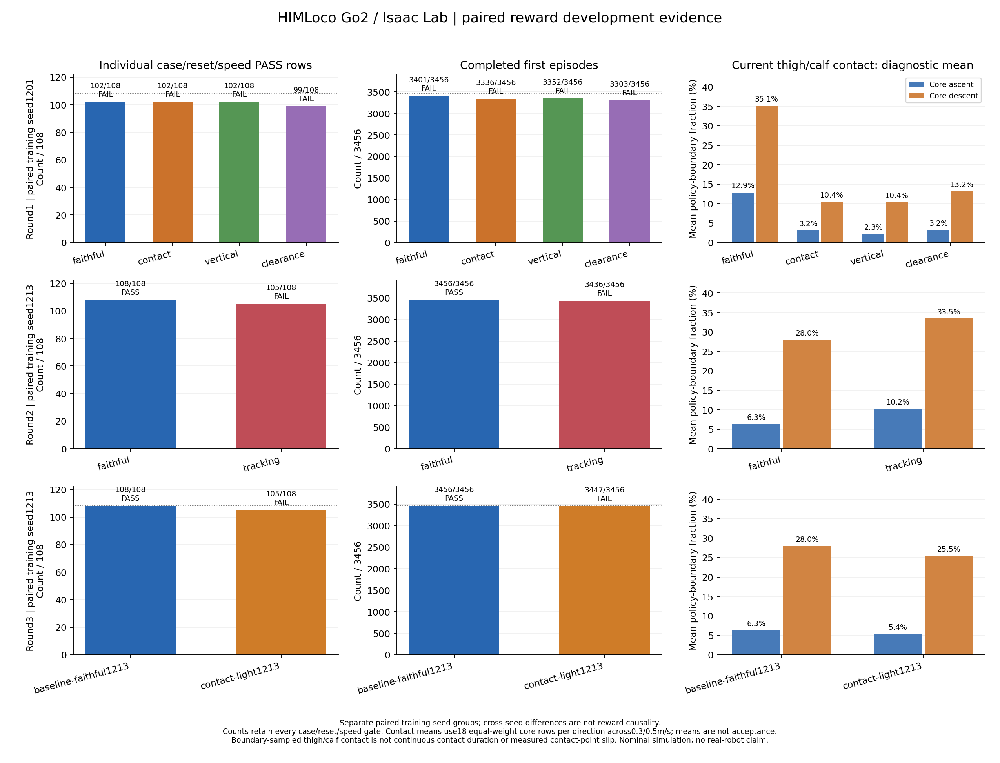
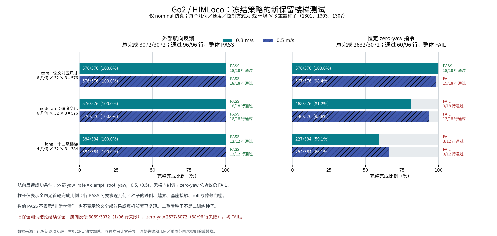

# Go2 / HIMLoco 第二晚训练与验证报告

日期：2026-10-11 夜间至 2026-10-12 早间（Asia/Shanghai）；用户授权计算截止 07:20。本文记录最终选定策略、成功范围、失败与复现边界。完整逐项数值以所链接的冻结结果为准。

## 结论

本晚保留了 HIM 估计器、HIMPPO 和本体历史策略结构，围绕原发布版奖励进行七组同预算续训。**最终保留原奖励的 seed1213 策略，而非修改奖励的策略。** 在新增保留测试中，带外部航向反馈的论文对应尺寸、适度变化楼梯和十二级楼梯均为 3072/3072 完成，零跌倒、越界和基座接触，96/96 个逐几何／重置种子／速度条目通过预先确定的数值门槛。

这支持“在明确的 Go2 仿真和航向控制条件下稳定上下这些楼梯”。完整复现论文效果仍未完成：恒定零 yaw 指令的楼梯测试失败，已知全向平地回归失败，成功下楼仍有腿段接触，尚不能认证“非常丝滑”。没有进行真机测试。旧保留测试中的失败和录像写帧缺陷均保留，新增测试没有覆盖或删除旧结论。

最终模型：[model_760.pt](../artifacts/go2-stairs-night2-faithful-seed1213-760/model_760.pt)，SHA256：

```text
039dfefe4798751b378342b792c1442d9025bfe76749572fa1a70eabae7b2472
```

部署导出：[policy.pt](../artifacts/go2-stairs-night2-faithful-seed1213-760/policy.pt)。名称中的“部署导出”只指 TorchScript 文件，不表示已经完成真机部署验证。

## 算法、环境与预算

actor 仅接收 6×45＝270 维本体历史，最新帧在前。HIM 输出三维速度和 16 维 latent，与当前 45 维观测组成 actor 的 64 维输入。187 点高度扫描仅供 critic；未向 actor 加入楼梯地图、视觉、地形编号或足端规划器。HIM 的 prototype 对比学习、HIMPPO 路线及 MLP 结构保留。

使用本机已有 `isaaclab-local-lab-1` 容器、Isaac Lab / Isaac Sim、Go2 USD 及 RTX 5080 Laptop GPU。每个正式新训练臂从同一 control660 起点续训，7680 个并行环境，100 rollout steps，100 个新增已保存更新，共 76,800,000 新环境步；七臂合计 537,600,000 步。PPO 与 HIM 的 Adam 状态保留，学习率均固定为 1e-4。不同轮用同种子配对比较，跨种子差异不归因于奖励。

七个正式训练臂资源采样峰值最高 13,596 MiB（约13.28 GiB），处于16 GB显存余量内。该数值来自间隔采样，不是连续测得的绝对峰值；见[训练资源汇总](stair-night2-training-resources-cpu.json)。

楼梯课程使用 `paper_mixed`：六级、1.2 m 宽、2 m 平台，以 0.25–0.65 m/s 前向命令训练，包含 11–20 cm 阶高、25/27/30/35 cm 踏深以及 0/1/2 cm 鼻沿。保留 16/27、17/25 cm 固定列，初始课程等级 4。用户本晚授权缩小验证范围，因此未继续把极端阶高、过短踏面或低摩擦组合当作本轮必过门槛；第一晚这些条件的失败仍保留。

## 三轮奖励实验

每个开发矩阵均含 18 个几何、3 个重置种子、0.3/0.5 m/s 两个速度，每个条目 32 个首轮环境，共 3456 次。这里的“通过行”还要求姿态、停顿、跌倒和接触门槛，不能用平均完成率代替。

| 轮次 | 训练奖励／改动 | 训练种子 | 完成/3456 | 通过行/108 | 开发数值 |
|---|---|---:|---:|---:|---|
| 1 | faithful：原发布版奖励 | 1201 | 3401 | 102 | FAIL |
| 1 | faithful＋腿段接触 −0.1 | 1201 | 3336 | 102 | FAIL |
| 1 | contact 的竖向速度惩罚 −2→−1 | 1201 | 3352 | 102 | FAIL |
| 1 | contact 的足端净空惩罚 −0.01→−0.02 | 1201 | 3303 | 99 | FAIL |
| 2 | faithful：原发布版奖励 | 1213 | **3456** | **108** | **PASS** |
| 2 | faithful 平面速度跟踪 1→1.5 | 1213 | 3436 | 105 | FAIL |
| 3 | faithful＋弱腿段接触 −0.02 | 1213 | 3447 | 105 | FAIL |



较强接触惩罚虽然减少部分腿段接触，但降低长梯可靠性；减轻竖向惩罚或增加净空惩罚没有统一改善。弱接触臂最终有 2 次跌倒、7 次越界，3/108 行失败。在双方都合格的 105 个匹配条目中，接触指标下降 82 项，但 jerk 上升 92 项、动作二阶变化上升 74 项、平面速度 RMSE 上升 75 项。因此没有用接触单指标挑选更差的运动策略。

faithful1201 与 faithful1213 的差异同时包含训练种子变化，不能由单个成功种子证明训练稳定可重复。本晚没有证据支持“奖励修改已胜过原奖励”。足端净空项以身体为参考，并不是精确相对当前踏面的摆腿净空；历史命名为 `shank` 的群体接触聚合实际包括 thigh＋calf。

证据：[第一轮开发](stair-night2-round1-development/comparison_zh.md)、[第二轮开发](stair-night2-round2-development/comparison_zh.md)、[第三轮弱接触开发](stair-night2-round3-development/contact-light1213-development-summary.md)、[第三轮动作质量配对比较](stair-night2-round3-development-motion.md)、[三轮图表数据](stair-night2-reward-comparison-three-rounds.json)。

第三轮选择在新保留测试之前冻结，依据仅为开发数据：[冻结文件](stair-night2-round3-selected-final-freeze.json)。冻结理由中的弱接触手写计数曾漏计一个仍符合 31/32 门槛的条目，原文件保持；正确总数为 3447 完成、7 越界，见[独立纠正](stair-night2-round3-freeze-count-correction.json)。该纠正未换模型或改变任何门槛。

## 新保留楼梯测试

冻结后测试 16 个几何、重置种子 1301/1303/1307、速度 0.3/0.5 m/s，分别运行外部航向反馈与恒定零 yaw 指令，共 192 个条目。每场景 512 环境，每几何 32 环境，首轮最长 40 s，保留每 20 ms 遥测。6 个 core 条件保留论文对应尺寸，另外 10 个为新的精确几何／长度组合。

| 范围 | 具体几何（上下楼分别计一项） |
|---|---|
| core，6 项 | 16/27 cm 五级；16/27 cm 六级；17/25 cm 六级 |
| moderate，6 项 | 14.5/32 cm 六级；17.5/29 cm 六级＋12 mm 鼻沿；19/31 cm 八级＋15 mm 鼻沿 |
| long，4 项 | 16.5/29 cm 十二级；18/31 cm 十二级＋12 mm 鼻沿 |

默认外部航向反馈仅为 `yaw_rate=clamp(-root_yaw, -0.5, +0.5)`，没有横向位置纠偏。它向 actor 提供 yaw 速度命令；不能把这组成功解释为 actor 独立保持世界坐标航向。zero-yaw 使用恒定 yaw 命令 0，actor 仍接收本体反馈。

| 控制方式 | 速度 m/s | core | moderate | long | 总完成 | 数值判定 |
|---|---:|---:|---:|---:|---:|---|
| 航向反馈 | 0.3 | 576/576 | 576/576 | 384/384 | **1536/1536** | PASS |
| 航向反馈 | 0.5 | 576/576 | 576/576 | 384/384 | **1536/1536** | PASS |
| zero-yaw | 0.3 | 576/576 | 468/576 | 227/384 | 1271/1536 | FAIL |
| zero-yaw | 0.5 | 567/576 | 540/576 | 254/384 | 1361/1536 | FAIL |

航向反馈两速度合计 3072/3072，96/96 行通过，零跌倒、停滞、越界及基座接触。zero-yaw 两速度合计 2632/3072，60/96 行通过；0.3 m/s 记录 98 跌倒、173 越界、87 基座接触，0.5 m/s 为 18 跌倒、158 越界、15 基座接触。不同失败标记可以重叠，不可相加作为互斥失败总数。

逐行门槛：32 环境至少 31 完成；基座接触为 0；core 跌倒必须为 0，其他范围跌倒／停滞／越界各不超过 5%；roll RMS≤0.15 rad、峰值≤0.35 rad、梯段最长停顿≤1 s；同时核验有效起态、物理有限性和首轮完成条件。完成要求全四足离开最后一级、落在目标平台范围及高度容差内，机器人直立、至少两足接触，并连续保持 0.5 s。根节点进度或“已经过若干阶”均不替代完成。

本轮数值通过不替代下文完整录像和接触判断；恒定零 yaw 的失败使完整双控制方式协议仍为 FAIL。

证据：[新保留测试逐项报告](stair-night2-round3-final-small-archive/baseline-faithful1213-final-summary.md)、[独立CPU审查](stair-night2-round3-final-small-archive/independent-cpu-audit_zh.md)、[完整小型manifest](stair-night2-round3-final-small-archive/immutable-manifest.json)。



## 旧保留测试与复测边界

第二轮冻结后的旧保留测试使用种子 907/911/919 和另一组精确几何，航向反馈完成 3069/3072，十二级快速下楼有 3 次越界、1/96 行失败。zero-yaw 完成 2677/3072、38/96 行失败。原结果与失败不变：[旧保留测试](stair-night2-final-validation/comparison_zh.md)。

第三轮增加弱接触奖励消融，仍仅按开发数据保留 faithful1213，然后预声明新的保留几何／种子。新保留结果是补充证据，不是第一次盲测，也不能用 3072/3072 擦除旧 3069/3072。弱接触并未在最终测试后重新调参。

旧匹配 control660 对照中，faithful1213 在共同成功的 core＋moderate 条目上降低动作二阶变化、jerk 和平面速度 RMSE，但腿段接触采样占比上升。因此可以报告部分运动指标改善，不能笼统称所有运动质量都改善。

## 录像与运动质量

前七项已完整审查 3877 个保留帧、67 页，CPU逐项核对612566个CSV／原始trace标量对，0差异；每项整数缓存编码、原片完整解码和终点四足平台／0.5s保持均核验。七个固定env0都连续成功，各自32环境也均32/32完成，但不能认证非常丝滑。

代表下楼接触：五级16/27 cm、0.3 m/s 的FR calf为146/594边界样本＞1 N，峰106.33 N；六级16/27 cm、0.3 m/s为163/644（25.31%），峰215.43 N，最长34个相邻样本（名义曝光0.68 s）；同六级0.5 m/s的FL/FR calf为85/396与35/396，峰117.56/144.31 N。完成和无基座接触并不等于足端独立支撑、没有腿段刮碰。

后七项也完成4731帧、82页完整审查，747498个CSV／原始trace标量对核验0差异。14项合计 **8608帧、149页、1360064个标量对**，固定env0均连续完成，各录像场景32/32完成。十二级下楼FR calf363/1008样本＞1N（36.01%），峰185.05N，最长36相邻样本／名义曝光0.72s；这是明确的接触质量不足。

证据：[前七项完整帧序列审查](stair-night2-round3-front7-exact-video-review_zh.md)、[前七项CPU与视觉JSON](stair-night2-round3-front7-exact-video-review.json)、[后七项完整审查](stair-night2-round3-last7-exact-video-review_zh.md)、[后七项CPU与视觉JSON](stair-night2-round3-last7-exact-video-review.json)。

已查明旧 MoviePy 1.0.3 / NumPy 2 路径会跳过或重复 RGB 缓存帧，即使总帧数看似正常也不能证明完整覆盖。旧 12 项的 7195 个实际编码帧曾完整审查，这一工作事实保留；旧 14 项均不能认证与每个 20 ms 物理边界精确对应。旧数值遥测仍可独立报告，不能继续与同索引旧图绑定接触时刻。见[旧证据纠正](stair-night2-old-video-claim-audit_zh.md)。

修复仅在项目 `--video` 入口启用隔离 overlay，整数顺序读取 RGB 缓存，每项一次；未修改共享安装包、训练入口或驱动。容器 CPU 已验证 392/402/957/963/2000 个缓存项经过 libx264 编码、解码后编号严格为 0..N−1。本轮固定 14 项录像使用 env0、重置种子1301，失败不换环境挑片；逐项核验写帧标记、数量、依赖与源码 hash、完整首轮边界、遥测及无遗漏联系表。审查模式为完整帧序列审查，不声称实时连续播放。

整数缓存顺序证明解决写帧遗漏／重复，不独立证明渲染器与物理传感器精确同步。接触占比、峰值及相邻边界采样的曝光仅是20 ms采样统计，不是测得步内连续接触时长；foot-link速度也不是接触点真实切向滑移。

批处理在第11项GPU正常结束后意外退出143，原因未确定。原10项材料和原manifest保持；第11项从已有成功wrapper／result／MP4经同一核验函数作CPU恢复，无GPU重跑；余3项使用新subset目录按原env0／seed1301完成。三处来源和中断明确记录在[恢复说明](stair-night2-round3-video-orchestrator-recovery.json)，没有把原manifest改写为完整成功。

本机可直接查看[14项首轮录像、帧页与遥测入口](stair-night2-round3-video-index_zh.md)。视频不进入Git，路径／hash和审查证据保留。

## 平地回归

旧冻结策略七命令回归仅正向 0.3/0.5 m/s 通过，共 2/7；倒退、侧移和转向明显退化。左移 64/64 跌倒，右移 59/64 跌倒，正 yaw 51/64 跌倒；反向与负 yaw 即便存活也几乎不跟随命令。该结果保留：[旧平地回归](stair-night2-selected-flat-regression.md)。

本轮同一冻结 actor/HIM 用种子1301完成零梯度七命令回归，仍为 **2/7，FAIL**，结果与旧种子一致：正向0.3/0.5 m/s通过；倒退XY MAE0.49985 m/s；左移0/64存活、右移5/64存活；正yaw13/64存活、yaw MAE0.39734 rad/s；负yaw64/64存活但yaw MAE0.49828 rad/s。没有将因过早跌倒而无法采样的速度误差填成0。

critic由235维重建为48维，零训练更新。实际22个actor/HIM/std张量保持，140×270固定输入的CPU输出与完整楼梯模型、原导出及实际平地导出最大差均为0，CUDA未初始化。回归失败来自该策略的运动行为，不是仅因critic维度重建而误载actor。[新平地逐项结果](stair-night2-round3-selected-flat-regression.md)、[实际导出CPU核验](stair-night2-round3-flat-actual-transfer-cpu.json)。

## 百级楼梯诊断

预声明单段100级、17/25 cm、上下双方向、各32环境、0.3 m/s、最长250 s、单种子1301的诊断已经运行，GPU wrapper于07:01:14正常结束。上楼 **0/32完成**（20跌倒、3停滞、9越界），下楼 **7/32完成**（3跌倒、22越界），总体7/64、FAIL；总基座接触23环境。root进度没有代替四足完成，更不等同于论文真机长梯成绩。

实际执行5842个控制步（116.84 s全局仿真时间），而非请求上限12500步；所有首轮均已完成或结束后收集器提前停止，退出0仅代表进程正常。最长250 s仍是场景与episode的上限，不应写成每个失败环境都生存250 s。独立CPU按原纯函数门槛重新判定两方向均FAIL；上楼最长停顿3.74 s，下楼横滚峰值0.846 rad。平均最大躯干进度上楼11.048 m、下楼13.851 m，进度虽可作为诊断，却不能替代平台完整完成。

证据：[预声明方案](stair-night2-round3-optional-long100-both-plan.json)、[实际独立CPU报告](stair-night2-round3-optional-long100-both-result-cpu_zh.md)、[逐环境进度／终态／身份核验JSON](stair-night2-round3-optional-long100-both-result-cpu.json)。没有录制100级视频，因此未作其图像或流畅性认证。

## 与论文的差异及尚未实现部分

原论文短梯为 A1 两组五阶16/27 cm、20次真机100%；长梯为 Aliengo 的百余阶17/25 cm，报告176.5±7.81阶。本任务用 Go2 仿真对齐部分尺寸，没有复现原两组短梯布置、相同机器人、相同仿真器或真机条件，因此没有同等或优于论文的直接对照证据。

迁移采用 Isaac Lab / Sim 代替 Isaac Gym Preview4，critic235与原238差3个扰动力通道，扫描和噪声实现不同；已有终止观测与 timeout bootstrap 移植修正，以及 std／nonfinite 保护。7680环境、固定1e-4、历史contact660续训、前向楼梯课程也不同于原4096环境、adaptive初始1e-3、从头多地形全向训练。保留主要算法公式不等于完整训练设置相同。

train＋domain none仍有startup质量0.8–1.25倍和COM随机；本次 evaluate none删除质量／COM／PD随机，三个reset种子仅为nominal初态复测，不是三组独立动力学环境。foot0.8/0.6和terrain1/1、multiply材料读回不代表真实木材／金属或已测solver等效摩擦。本轮没有新的多材料或动力学鲁棒性验证。

下一阶段优先恢复全向命令覆盖和无需外部航向反馈的稳定性，保留当前成功楼梯的回放／混合课程；在此基础上再比较较小腿段接触奖励、抬脚轨迹与动作变化惩罚。应使用相同起点、预算及多训练种子，分开报告完成可靠性和腿段接触；本晚结果不足以支持直接增大接触惩罚或更换算法。

## 文件管理、版本与复现入口

模型与小型证据纳入 Git；原始仿真密集遥测、完整录像和config主要在 `/home/cone/Research/HIMLoco/isaaclab/logs/`（Git忽略），任务wrapper日志、首轮裁剪录像和审查材料在 `/home/cone/robotics/logs/`。公共仿真环境仍由现有容器管理，没有复制进项目或更改显卡驱动、系统CUDA和图形配置。

最后GPU仿真于07:01:14结束，早于07:20截止；07:03只读核验没有存活的本项目run.py，显存读回16 MiB。指定五个驱动／相关配置文件hash均与夜初相同，范围明确为这五项而不是全系统取证，见[最终驱动与空闲读回](stair-night2-driver-and-idle-final.json)。停止追加训练是为在截止前完成固定验证和证据保存，并非判断论文完整复现目标已经达成。

外部数据包：[night2-20261012-evaluation-data.tar.gz](/home/cone/robotics/artifacts/night2-20261012-evaluation-data.tar.gz)，压缩后3,952,134,253 bytes，覆盖939份文件、21,602,394,300逻辑原始bytes；939/939成员均经流式解压SHA／大小校验通过。包SHA256：`07281c8f7e039c17e253d5af1faa0f9781cbeb2e29eaf6e81ecf4624a6e56b44`。29个完整原MP4保持外部路径／hash引用，首轮片段与密集遥测嵌入包；图片联系表和模型权重不重复嵌入。包发布用同inode的`.partial`硬链接保留，不重复占用数据空间。

来源和核验：[manifest](stair-night2-evaluation-archive-final-manifest.json)、[逐成员校验收据](stair-night2-evaluation-archive-final-manifest.json.receipt.json)、[恢复／重建说明](stair-night2-evaluation-archive-recovery_zh.md)。恢复时需要完整Git历史及对应模型，因为CPU汇总会验证跨commit源码身份。晚完成的后七项／百级CPU审查以独立小补包保存，不改已经冻结的大包manifest。

小补包：[night2-20261012-evaluation-review-supplement.tar.gz](/home/cone/robotics/artifacts/night2-20261012-evaluation-review-supplement.tar.gz)，93,744 bytes，6/6成员经SHA／大小校验通过；包SHA256：`8cc17ef53000df97b4ebbc3f65e3df48414213947d135d246225ccf1440d370f`。[补包manifest](stair-night2-evaluation-review-supplement-manifest.json)与[收据](stair-night2-evaluation-review-supplement-manifest.json.receipt.json)绑定大包SHA并保存最后一项独立视觉观察、后七项和百级CPU报告。全部实际计算早于截止，截止附近及之后仅做CPU审查／归档和Git收尾。

工作分支为 `feature/stair-rewards-night2-20261012`。主要证据已保存于 `32e1cc8d1c935651202cb223ebbd118d57732727`，GitHub CLI与MCP均精确核验远端该SHA；本报告、后七项／百级审查及归档收据保存在其后续最终收尾提交。没有force push、覆盖main或抹去失败实验。

从仓库根目录运行，使用冻结策略重复新保留几何的单种子、单速度场景示例：

```bash
bash isaaclab/run.sh evaluate --terrain stairs \
  --checkpoint artifacts/go2-stairs-night2-faithful-seed1213-760/model_760.pt \
  --reward_profile faithful --num_envs 512 \
  --stair_batch reproduction/stair-night2-round3-reserved-geometries.json \
  --speed 0.3 --eval_seconds 40 --eval_randomized --eval_seed 1301 \
  --seed 1 --domain_profile none --viz none
```

完整矩阵应使用已保存的 geometry、evaluation plan、冻结选择及运行 manifest，以免单场景替代总体结论。夜间 wrapper 内有用户截止保护，截止后复测需要明确的新执行时间范围。
