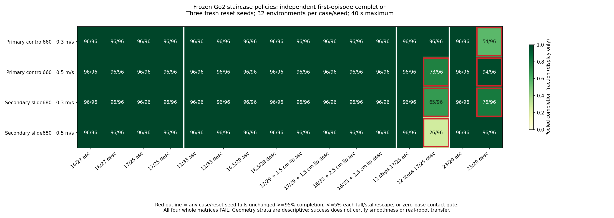
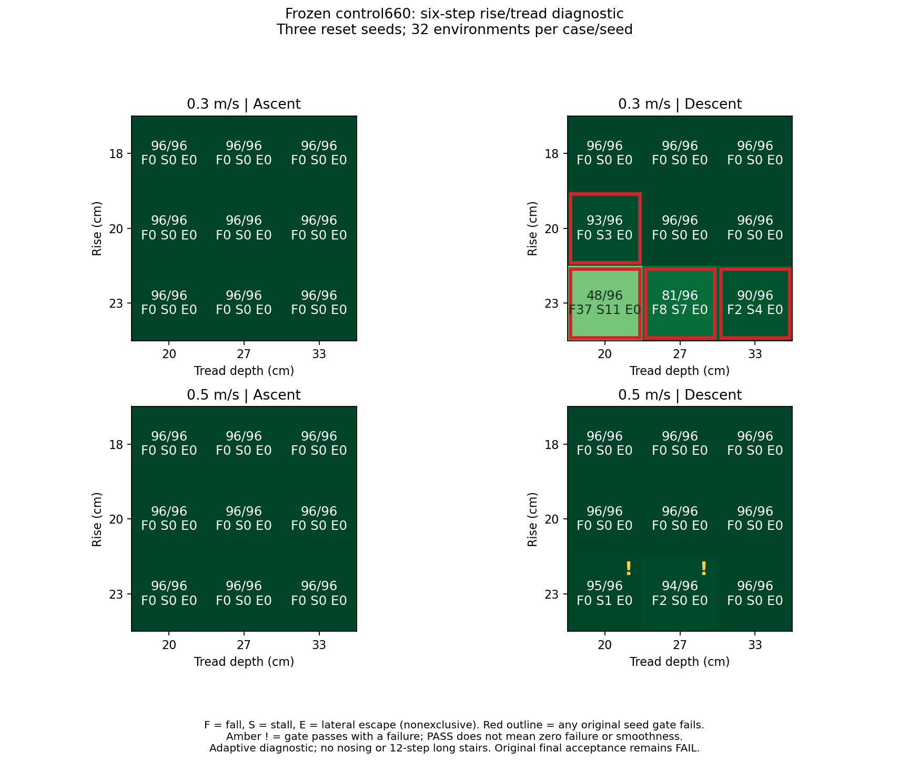
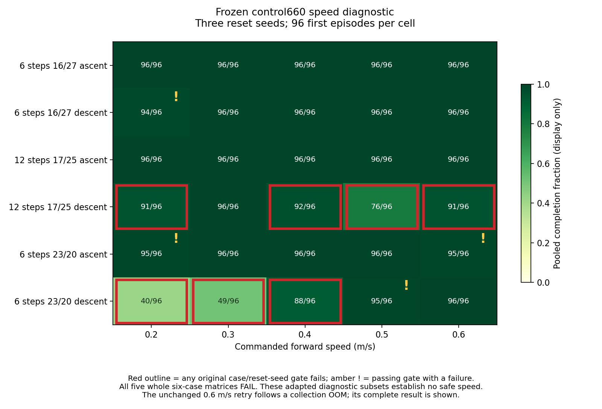
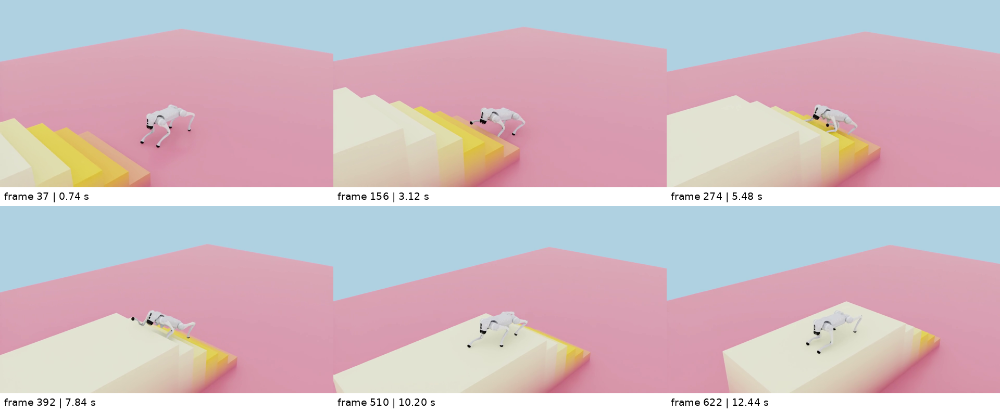
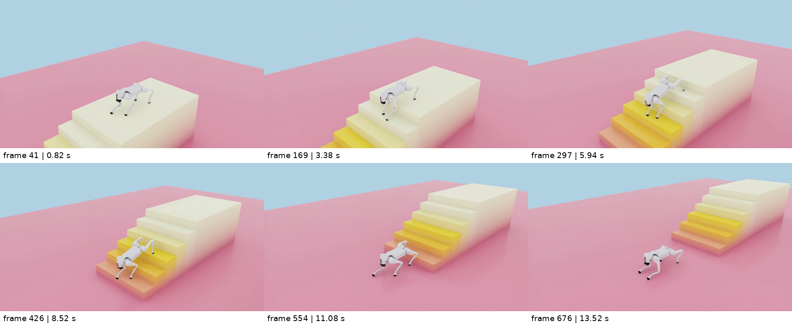

# Go2 EDU / HIM 楼梯夜间实验记录

本次已在 RTX 5080 Laptop 上运行 CUDA PhysX 楼梯训练，得到可归档、可加载的上下楼策略。主候选在论文对应尺寸和多数未训练楼梯上通过了独立随机初态测试，**但完整最终矩阵未通过，尚未达到“全面复现论文效果、丝滑上下楼”的目标**。23 cm 高、20 cm 深的陡梯下楼、较快的长梯下楼，以及较高摩擦条件仍存在明确失败。没有运行 Go2 真机。

自主任务从 2026-10-11 00:29:13 开始，预算至 07:29:13，北京时间。原冻结协议的 11 次采集已于 06:25:16 全部完成；33 项冻结文件哈希核对通过。采集完成不代表科学验收通过；后续速度、尺寸、电机曲线与高速度动力学测试是单独预写协议的诊断，不改变原验收或模型选择。

[离线结果查看器](stair-results-viewer.html) 可以切换各矩阵、点击格子查看三个种子的精确失败记录，并播放本机七段视频。页面不需要联网；MP4 与完整逐帧图页留在本机，不随 Git 下载。

## 保存的策略与训练范围

| 模型 | 用途 | 从 contact620 继续的已保存更新 | 奖励差异 | 输入／输出 |
| --- | --- | ---: | --- | --- |
| [control660](../artifacts/go2-stairs-control660/) | 05:47 冻结的主候选 | 40 | 发布版 Go1 奖励全部保留，新增八个 thigh/calf 接触计数惩罚 −0.1 | 270 / 12 |
| [slide680](../artifacts/go2-stairs-slide680/) | 同时冻结的固定对照 | 60 | 在 contact 上追加原有 feet_slide_l2，权重 −0.05 | 270 / 12 |
| [standard370](../artifacts/go2-stairs-standard370/) | 早期标准楼梯对照 | 不适用 | faithful | 270 / 12 |

每个模型目录保存完整 checkpoint、CPU TorchScript、训练配置和 SHA256 清单。主候选的训练请求为额外 100 次，但被中止；模型只保存继续 40 次更新，控制台观察到 48 次完整更新，后续未保存更新不计入该权重。具体见 [截断记录](stair-contact-control660-truncation.json)。不能称它完成了 100 次续训。

最后两条训练分支均从同一归档 contact620 起步，4096 个并行环境，每轮每环境 100 步，保留 Adam 动量，PPO/HIM 学习率均显式设为固定 1e−4。训练初始课程等级 0–4，前进指令 0.25–0.65 m/s。此前经过 bootstrap、easy、standard、hard 课程；bootstrap 是首阶停滞后的 Go2 迁移调整，并非原论文课程。训练课程加入真实三角网格悬挑边沿，未用高度场替代下表面。

00:46–05:50 的 910 个资源采样中，总显卡占用峰值为 14,058 MiB，约 13.73 GiB，最高温度 63°C。采样没有覆盖整个七小时，且占用是所有 GPU 进程的总和，不是某个模型的独立分配量；原始采样和范围见 [资源记录](overnight-resource-summary.json)。

调参矩阵的 24 种楼梯、三个既用初态种子、每场景每种子 32 个环境中，control660 和 slide680 在 0.3、0.5 m/s 都完成 2304/2304 次且没有失败标记。这些调参结果没有代替独立最终验收。增加力惩罚的分支、后续训练回退、平地及早期停滞等结果均保留，见 [匹配消融](stair-matched-contact-ablation.md)、[力惩罚对照](stair-force-controlled-comparison.md)、[脚滑对照](stair-slide-checkpoint-comparison.md)。本次只有一个训练随机种子，不能将差异视为跨训练种子的因果结论。

## 独立最终验收

[冻结计划](stair-final-evaluation-plan.json) 在 05:47:03 写入两个权重、28 个运行源文件和验收／几何文件哈希。每次启动都核对这些哈希。主候选和对照的选择保持固定，最终结果没有用于重选模型或继续调参。

最终 16 场景，每场景 32 个环境，使用新的初态种子 101、211、307，每次最长 40 秒。门槛保持每个场景、每个种子完成率至少 95%，跌倒／停滞／横向越界各不超过 5%，机身接触为零；32 个环境中 31 次完成可过完成率门槛，30 次不可过。只统计第一次 episode，自动重置后的结果不会覆盖首次失败。全梯和四脚到达终点平台才计完成，零动作负对照也保留。

| 主候选分层 | 0.3 m/s | 0.5 m/s | 解释 |
| --- | ---: | ---: | --- |
| 论文对应几何，4 场景 | 384/384，PASS | 384/384，PASS | 16/27 cm、17/25 cm 的六级上下楼；机器人已换为 Go2 |
| 未训练几何，8 场景 | 768/768，PASS | 768/768，PASS | 11/33、16.5/29 cm；1.5/2.5 cm 突出边沿 |
| 12 级长梯，2 场景 | 192/192，PASS | 169/192，FAIL | 0.5 m/s 的下楼横向偏移为主要失败 |
| 23/20 cm 陡梯，2 场景 | 150/192，FAIL | 190/192，FAIL | 失败集中在下楼；上楼均为 96/96 |
| **完整 16 场景** | **1494/1536，FAIL** | **1511/1536，FAIL** | 任一场景／种子失败就保留总体 FAIL |

主候选在 0.3 m/s 的陡梯下楼，各种子完成 12/32、25/32、17/32；在 0.5 m/s 长梯下楼完成 27/32、21/32、25/32。固定对照 slide680 的完整矩阵为 1485/1536（0.3 m/s）、1466/1536（0.5 m/s），也未通过；后者长梯下楼仅 11/32、5/32、10/32。降低脚滑代理值并未保证长梯可靠性。

分层 PASS 只说明该几何子集通过本次门槛，不改变全矩阵 FAIL。完整逐场景／种子、失败端点、采样及物理读回见 [冻结最终验证](stair-frozen-final-validation.md)，其 CSV 和无损 JSON.gz 保留详细数值。



## 摩擦、动力学、航向和平地

摩擦测试只改足端，使用 basic 场景，地形 authored 静／动摩擦为 1/1，combine 为 multiply。实际足端参数有读回核对，但没有测量后端最终接触对系数，也未标定真实木质／金属／瓷砖等材料。

| 足端静／动摩擦 | 0.3 m/s 完成次数／门槛 | 0.5 m/s 完成次数／门槛 |
| --- | ---: | ---: |
| 0.8 / 0.6，标称 | 1498/1536，FAIL | 1520/1536，FAIL |
| 0.45 / 0.35，较低 | 1532/1536，FAIL | 1535/1536，PASS，有一次跌倒 |
| 1.0 / 0.8，较高 | 1410/1536，FAIL | 1395/1536，FAIL |

较低摩擦改善了这组陡梯下楼完成次数，但仍有跌倒／机身接触，不能推断“摩擦越低越好”。较高摩擦除陡梯外，还导致带 2.5 cm 边沿的上楼停滞，证明目前材料鲁棒性不足。0.5 m/s 低摩擦单点虽然通过统计门槛，但仍有一次上楼跌倒，也不能证明全材料范围鲁棒。0.5 m/s 的同样三组摩擦是另行预写协议的补充测试，结果见 [材料补充](stair-frozen-material-speed05.md)；它们不改变原验收协议或模型选择。

动力学原计划使用 construction seeds 71、73、79，重建环境后采样 base 质量／惯量和 COM，reset 采样 ±10% PD 增益，固定标称足端摩擦，速度 0.3 m/s。三组分别完成 **1420/1536、1405/1536、1429/1536，全部 FAIL**；不仅陡梯和长梯，论文对应与未训练几何也各有失败。0.5 m/s 的同构造种子补充完成 **1501/1536、1486/1536、1492/1536，全部 FAIL**。质量、惯量、COM 和 PD 参数有前后读回核对，但 PD 前后读回包括自动重置，不等于保存了每个第一次 episode 的精确增益分配。重复初态种子不会重新采样 startup 质量／COM；没有加入经标定的电机强度、通信／动作延迟或温度／电池因素，不能称完整真机域随机化。高速度补充保持独立，详见 [动力学高速度诊断](stair-frozen-dynamics-speed05.md)。

标准 12 场景的外部航向控制对照在 0.3 m/s、种子 401/409/419 完成 1152/1152 次且零失败。该控制器仅根据 yaw 请求 `clamp(−yaw, ±0.5)` rad/s，没有横向位置纠偏。把 yaw 指令固定为零后仅完成 1050/1152 次，记录 95 个横向越界、7 个跌倒标记及 2 个机身接触，门槛 FAIL。对 12 场景 × 3 种子指标等权平均，航向误差从 0.00868 增至 0.06500 rad，横向误差从 0.0693 增至 0.1077 m；这不是所有有效时间样本的合并均值。策略仍接收 IMU／关节反馈，不能称整个机器人开环运行；该标准 12 场景、0.3 m/s、所测种子下的验收可靠性依赖默认外部航向反馈。

楼梯权重在平地六条指令下做零梯度回归，各 64 环境、20 秒。`warm_start reset` 仅为尺寸适配重建 critic，保留 actor、HIM 和 std。整体 **FAIL，仅三条指令通过**；此前专用平地 model460 的通过结果不能替代此回归。

| 指令 | 首轮存活 | XY MAE (m/s) | Yaw MAE (rad/s) | 门槛／表现 |
| --- | ---: | ---: | ---: | --- |
| 前进 0.3 m/s | 64/64 | 0.02830 | 0.01784 | PASS |
| 前进 0.5 m/s | 64/64 | 0.02841 | 0.02335 | PASS |
| 后退 −0.5 m/s | 64/64 | 0.49997 | 0.00046 | FAIL，几乎原地 |
| 侧移 0.3 m/s | 0/64 | 0.62515 | 0.77098 | FAIL，平均约 2.27 秒首轮结束 |
| 转向 +0.5 rad/s | 62/64 | 0.07697 | 0.21742 | PASS，但有两次跌倒，实际均值约 +0.295 rad/s |
| 转向 −0.5 rad/s | 64/64 | 0.00081 | 0.49847 | FAIL，几乎不转 |

该回归揭示楼梯续训后的通用指令能力退化，与前向楼梯成功必须同时报告。此平地评价只是一组标称初态，没有逐轴 roll RMS／峰值或完整姿态轨迹；直立比例是 roll／pitch 合成倾角指标。完整结果和零动作对照见 [平地回归](stair-policy-frozen-flat-regression.md)。

为排查平地迁移时误覆盖 actor 的可能性，另在 CPU 上独立构造平地 critic 并复现 `warm_start reset`。22 个 actor／HIM／std 张量逐位一致，135 组输入下，重建网络、实际平地导出和冻结楼梯导出的动作最大差异均为 0。该核查未发现加载／导出失配，但不能证明所有观测或物理实现均正确，见 [独立迁移核查](frozen-flat-transfer-independent-audit.md)。

## 固定模型的尺寸、速度与失败诊断

速度扫描采用六种已打开弱点相关几何：常规六级、12 级长梯和 23/20 cm 陡梯的上下楼，另用初态种子 503/509/521。0.2、0.3、0.4、0.5、0.6 m/s 分别完成 **512、529、564、555、570 / 576**，六场景总体均 FAIL。0.6 m/s 虽然陡梯下楼 96/96 无失败，却出现长梯下楼越界及陡梯上楼跌倒；因此不能用一个速度覆盖所有楼梯。首次 0.6 m/s 采集因残留进程占用显存而 OOM，没有结果；清理明确属于本任务且已完整保存的孤儿进程后，按原协议重试完成。该采集失败与策略失败分别保留，见 [速度扫描](stair-frozen-speed-probe.md)。

尺寸边界图另用种子 601/607/613，覆盖 18/20/23 cm 台阶高度 × 20/27/33 cm 踏面深度 × 上下楼，共 18 种六级楼梯，每种每种子 32 环境。0.3 m/s 完成 **1656/1728，FAIL**，全部上楼成功，失败集中在 20/20 cm 和三种 23 cm 下楼。0.5 m/s 完成 **1725/1728，所有场景／种子通过统计门槛**，但 23/20 cm 下楼有一次停滞，23/27 cm 下楼有两次跌倒，最长停顿 3.72 s。它不包含 12 级长梯，也没有认证流畅性。尺寸选择是在原最终失败后做出的诊断，即使使用新初态种子，也不是全新的最终验收或安全运行范围，详见 [尺寸边界图](stair-frozen-height-depth-probe.md)。





长梯 CPU 诊断逐个核对 123 个越界终点，全部由 **RR_foot** 在梯段内越出 ±0.65 m 触发，而 root 仍在界内。只看机身轨迹会漏掉这些失败；默认航向控制没有横向位置纠偏，近零 yaw 仍可累积侧向偏移。slide680 的足端滑移代理更低，却有更大的横向失败。陡梯低速失败多集中在首阶，另有小腿承载、足端无接触的停滞样本。这些是相关诊断，不足以断言奖励项、摩擦或某个碰撞点造成失败，见 [长梯失败诊断](stair-frozen-failure-diagnosis.md) 和 [陡梯关联诊断](stair-stretch-association-review.md)。

## 录像与运动质量

以下完整第一次 episode 的 MP4 保留在本机 `reproduction/`，视频被 Git 忽略。Git 内保存片段来源、精确帧数／时间、SHA256、概览图片和逐帧遥测。

| 片段 | 环境 | 有效时长／帧数 | 本地文件 |
| --- | ---: | --- | --- |
| 六级 16/27 cm 上楼 | 0 | 12.46 s / 623 | `frozen-control660-16cm-asc-first-episode.mp4` |
| 六级 16/27 cm 下楼 | 0 | 13.56 s / 678 | `frozen-control660-16cm-desc-first-episode.mp4` |
| 十二级 17/25 cm 上楼 | 384 | 17.80 s / 890 | `frozen-control660-long12-asc-first-episode.mp4` |
| 十二级 17/25 cm 下楼 | 416 | 20.42 s / 1021 | `frozen-control660-long12-desc-first-episode.mp4` |

四段均为 0.3 m/s、初态种子 101 的指定环境，不能代表所有环境。片段排除了完成后置零动作阶段；完整帧序列审查与 20 ms 遥测覆盖报告在 [逐帧审查](frozen-control660-complete-frame-sequence-review.md)。逐帧检查不是实际连续实时播放，验收中的 continuous-video 条件仍未证成。概览图片只是帮助定位，不作为平滑性证明。





常规片段没有长停顿或机身接触，但仍有小腿接触。上楼指定环境 FL_calf 当前净法向接触力向量的范数峰约 168 N；下楼 FR_calf 当前峰约 101 N、保留历史峰约 253 N。该范数含立面法向分量，不是单独竖直分量，也不含切向摩擦。足端 world-XY 速度是脚滑代理，不能等同接触点沿地面的真实滑动；采样也可能漏掉一个物理子步内的碰撞。成功完成与流畅、少碰阶必须分开评价。

按训练前写入的运动质量参考核查，即使只描述通过穿越门槛的 case×reset-seed 行，0.3 m/s 的 45 行中仍有 21 行当前接触足端速度代理比例超过 0.15，0.5 m/s 的 44 行中有 41 行超过；这些分母是场景／初态指标行，不是机器人数量或接触时长。0.3 m/s 的陡梯上楼 seed211 还出现约 0.35324 rad 的 roll 峰值，略超 0.35 rad 参考，虽 32/32 完成且无失败标记。参考值没有重调，失败行也全部保留，详见 [运动参考项核查](stair-frozen-motion-reference-review.md)。足端代理未标定成真实接触点滑移，因此不直接认定这些机器人都在物理上打滑。

三个失败前片段也保留在本机，分别为快速长梯下楼越界、23/20 cm 陡梯下楼跌倒、高摩擦带边沿上楼停滞：`frozen-failure-long12-desc-prefailure.mp4`、`frozen-failure-stretch-desc-prefailure.mp4`、`frozen-failure-highfriction-lip-asc-prefailure.mp4`。这些片段明确不完整，排除了终止帧及额外一帧，共 40 ms，不能展示精确终止物理状态或当作完成录像。陡梯 env481 和边沿 env329 没有被 evaluator 的代表轨迹采样选中，仅有该环境的录像与终点；不能把 env480／320 的稠密轨迹配成它们的遥测。长梯 env416 有对应的 20 ms 轨迹。

[失败录像审查](frozen-pre-failure-frame-sequence-review.md) 完整覆盖 1112 帧、19 页，并核对重录与原失败的保存初态／终点。long416 终止时 RR_foot 当前及历史接触均未达到 >1 N 门控，足端以约 2.45 m/s 的 world-XY 速度移动越界；该单例不能称“接触点滑出”，仍按原位置门槛记 FAIL，也不能外推其他 122 个越界。三个概览只用于定位，完整逐帧检查仍不等于实时连续播放。

## 本机复查

使用已有 `/home/cone/isaaclab` 环境，仓库根目录执行完整冻结协议；它会启动 11 次仿真采集，退出码 0 只代表采集完成，应读取各原始 `result.json` 的 `final_acceptance.traversal_passed`。`policy.thresholds.completion_fraction=0.9` 是内部采集门槛，不能代替最终验收的 0.95：

```bash
bash reproduction/run-frozen-stair-validation.sh \
  artifacts/go2-stairs-control660/model_660.pt contact \
  /home/cone/robotics/logs/himloco-recheck
```

只复查一组常规上楼并录制：

```bash
bash isaaclab/run.sh evaluate --terrain stairs --reward_profile contact \
  --checkpoint artifacts/go2-stairs-control660/model_660.pt \
  --stair_height 0.16 --stair_depth 0.27 --stair_direction asc \
  --num_envs 32 --speed 0.3 --eval_seconds 40 --eval_randomized --eval_seed 101 \
  --eval_trace_stride 1 --video --video_policy_only --video_length 2000 \
  --video_isolate_env --video_env_index 0 --run_name control660-core-video
```

下楼把 `asc` 改为 `desc`。无录像时省略视频选项并用 `--viz none`；这个已有容器入口不接受 `--headless`。命令仅复用已有环境，没有重新安装系统软件。

重做主候选的保存更新预算示例（不会保证 GPU 逐位重现权重）：

```bash
bash isaaclab/run.sh train --terrain stairs --stair_stage hard --reward_profile contact \
  --checkpoint artifacts/go2-stairs-contact620/model_620.pt \
  --num_envs 4096 --steps_per_env 100 --max_iterations 40 \
  --learning_rate 0.0001 --resume_learning_rate 0.0001 --lr_schedule fixed \
  --start_level 4 --stair_speed_range 0.25 0.65 --seed 1 \
  --run_name control660-retrain --viz none
```

模型按固定 Lab 关节顺序输出，默认姿态、动作缩放 0.25、电机参数和观测尺度见模型旁配置。每帧 45 维本体数据、六帧最新在前；187 个高度样本只供 critic，总计 235 维训练输入，不在导出的 actor 中。CPU 导出与 checkpoint 的网络张量及 52 组输入已独立核对，输出最大差异为 0；这不是硬件接口验证。

## 环境保存与下一步

原版 Isaac Gym Preview 4 / Python 3.7 环境在 `/home/cone/robotics/`，标签 `original-cpu-baseline` 保留。它的 PyTorch 1.10 无法运行 RTX 5080 的 sm_120 内核，所以当前 GPU 路线复用 Isaac Lab 3 EA / Sim 6.1 / PyTorch 2.11 cu128。Go2 资产、DC 电机、接触物理和部分软件运行实现已经变化，不能称原软件平台完全相同的论文复现。

本轮没有扩展其他地形训练，因为楼梯流畅性目标仍未达成。接下来的独立阶段应先解决残留小腿碰阶与长梯横向误差，再以新保留的几何／种子验证，避免反复使用已打开的最终矩阵挑模型。速度／摩擦扫描和小腿电机曲线对照仅用于诊断；没有据此新增或晋升策略。

[下一独立阶段计划](stair-next-stage-plan_zh.md) 给出四组同起点、同更新预算的控制实验：指令覆盖／平地维持、入口与长梯课程、物理随机化、接触语义奖励。它们是待验证方案，本轮没有执行；每组保留对照、至少三个配对续训种子，重新冻结候选后使用新的几何／初态／动力学保留集。楼梯可靠性、全向平地、跟踪及运动质量须同时满足门槛，不能以其中一项改善抵消另一项退化。

真机迁移前仍缺电机曲线、动作延迟、输入轴向／四元数约定、关节重排和实际 PD 的逐项核对。原版 URDF 与 Lab 小腿峰值力矩／速度分别为 35.55 Nm / 20.07 rad/s 和 45.43 Nm / 15.70 rad/s。固定模型换用前者的 DC 曲线后，0.3 / 0.5 m/s 分别完成 1490/1536、1507/1536，整体仍 FAIL；常规与未训练几何仍全通。它在低速下峰值力矩更小、额定速度更高，不能笼统称整个速度域更保守。配置调用与参数读回的核查范围见 [小腿曲线敏感性](stair-frozen-calf-sensitivity.md)，不能判断用户 EDU 实际采用哪一套。

驱动约束始终保持：595.104.02；未修改驱动、系统 CUDA、Vulkan、Xorg、modprobe、系统电源或 DNS 配置。[只读驱动核查](driver-overnight-final-audit.json) 的版本与原保存五个文件哈希均一致；这五项不是整个系统的全文件审计。共享依赖保留在机器人通用目录，训练日志在 `isaaclab/logs/`，报告／权重在本仓库；没有把大型模拟器二进制或全量视频塞进 Git。

[交付状态快照](overnight-delivery-status.json) 保存 07:20 的只读收尾状态：33 项冻结源码／几何／权重哈希仍全部吻合，GPU 占用 16 MiB、温度 41°C，没有计算进程，容器仅保留原入口和 Omniverse Hub。该快照之后只做 Git 传输、离线版本备份及本任务临时防休眠服务清理，不再训练或调参。

所有本日已保存的配置／评估结果，包括调参和不完整采集尝试，共 227 个 JSON、约 5.55 GiB，另备份到共享目录 `/home/cone/robotics/archives/himloco-overnight-20261011/evaluation-data.tar.gz`，压缩后约 1.05 GiB。全部归档成员逐个 SHA256 核对原文件一致，Git 保存 [清单](overnight-evaluation-archive-manifest.json) 和 [归档脚本](archive-overnight-evaluation-data.py)。原数据没有移动或删除；该归档不含模拟器、权重、视频和 stdout 日志。

完整数值重建还需要同目录的 `supplemental-readbacks-and-protocol.tar.gz`：238 个物理／动力学读回、终止记录和协议／小型启动日志，约 338 KiB，见 [补充归档清单](overnight-supplemental-readbacks-archive-manifest.json)。原数据归档单独不足以重建全部报告。

[独立离线恢复核查](overnight-offline-restore-check.md) 从精确 Git `13fa5b9` 和两份归档恢复源码／权重及 465 个数据成员，在禁止读取原仓库／原日志、禁止导入模拟器与 Torch 的条件下，重建八组报告并运行六组 CPU 验证器。13,866 项检查通过，八个 CSV 与 Git 原报告逐字节一致，八个 JSON 仅归一化生成时间／工作路径后全字段一致。它证明数值归档可恢复，不代表重新训练、重新仿真或科学验收通过；原 FAIL、平地退化和流畅性未证成均保留。恢复副本、访问保护与命令日志也留在该共享归档目录。

[中文恢复指南](overnight-restore-guide_zh.md) 提供从精确 Git 与两份归档重建到全新目录的命令，以及七段 MP4 的可选单独复制方法。权重在 Git 中；视频和大型数据包仍需从本机共享目录保存。

七段 MP4 另备份在同一共享目录的 `first-episodes-and-prefailure-videos.tar`，约 10.84 MiB；七个成员的大小／SHA256 与原视频及已有来源记录全部一致，见 [视频备份清单](overnight-videos-archive-manifest.json)。它只保存四段完整首轮录像和三段失败前片段，不包含全部帧图或未裁剪源视频，也不改变运动质量结论。
