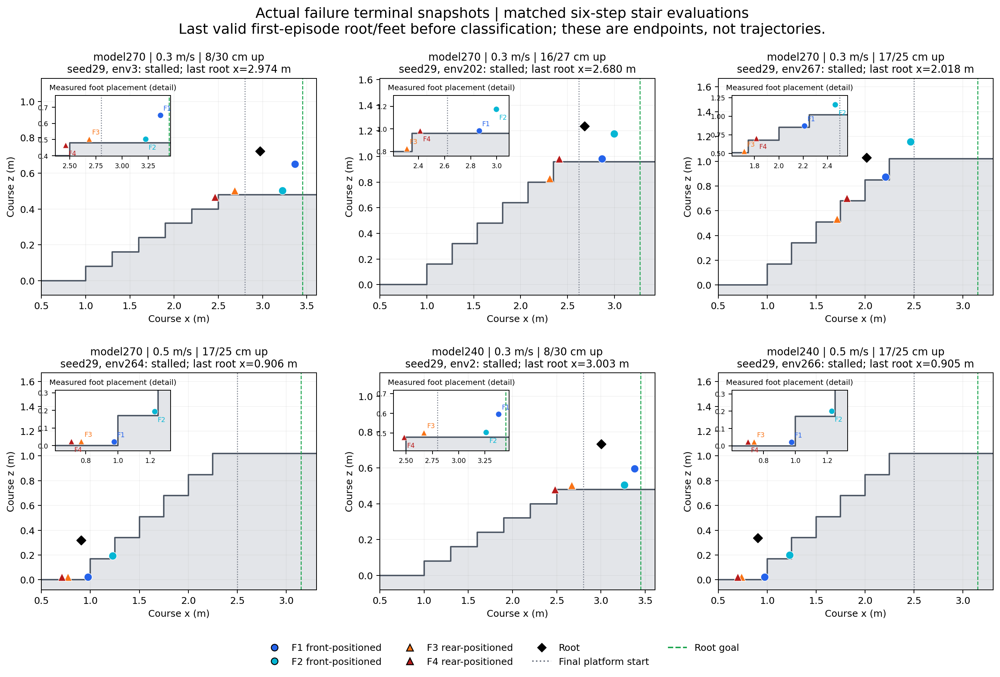
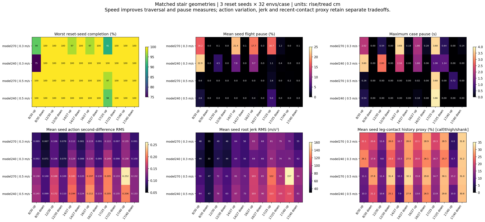

# Standard270 matched staircase analysis

**Refine before increasing stair difficulty.** Model270 at 0.5 m/s satisfies the current final traversal gate, but 0.3 m/s still has actual rear-foot stalls and short-tread traversal remains speed-sensitive. Faster travel reduces pauses while increasing action variation and root jerk. These results establish traversal at the stated conditions, without certifying smooth motion or robustness beyond them.

## Matched experiment and acceptance

The two independent frozen-checkpoint evaluations use identical twelve six-step geometries, 1.2 m width, no nosing and 2 m landings. Reset seeds are 11/29/47, with 32 environments per case/seed (96 per case; 1152 per model/speed). The same model has exactly equal initial root-position arrays between 0.3 and 0.5 m/s, along with matching heading control and thresholds. All tests use randomized reset poses and nominal dynamics. Saved initial/final PhysX foot-material readbacks match across both runs: static friction 0.8, dynamic friction 0.6 and restitution 0, with zero dispersion across all 384×4 feet and fixed configured ranges. A separate physical terrain-material readback is absent from these files. Reset seeds do not resample startup materials/dynamics; the fixed material evidence does not establish randomized-dynamics validation.

| Checkpoint / speed m/s | Completed | Stalls | Worst case/seed completion | Final traversal gate |
|---|---:|---:|---:|---|
| 270 / 0.3 | 1137/1152 | 15 | 0.90625 | FAIL |
| 240 / 0.3 | 1131/1152 | 21 | 0.75000 | FAIL |
| 270 / 0.5 | 1151/1152 | 1 | 0.96875 | PASS |
| 240 / 0.5 | 1147/1152 | 5 | 0.93750 | FAIL |

Every failure above is a stall. Falls, lateral escapes, timeouts, nonfinite states, invalid physics, invalid starts and base-contact environments are zero for all four combinations. The original 90% evaluation gate passes model270 at both speeds and model240 at 0.5 m/s, but fails model240 at 0.3 m/s. The final gate requires 95% completion in **each case/seed** and no more than 5% failures, so pooled completion alone cannot pass a candidate. Model270/0.5 passes that traversal gate, while its 3.68 s maximum pause still sets `motion_improvement_needed=True` and `smoothness_verified=False`. Model200/0.3, retained as context in the combined raw summary, completes 952/1152 and has 200 stalls; it is excluded from the matched 48-row metric artifact.

Cells below contain pooled completed/96 followed by the worst reset-seed completed/32. Rise/tread dimensions are centimetres.

| Case | 270 / 0.3 | 240 / 0.3 | 270 / 0.5 | 240 / 0.5 |
|---|---:|---:|---:|---:|
| 0: 8/30 cm asc | 91/96; 30/32 | 75/96; 24/32 | 96/96; 32/32 | 96/96; 32/32 |
| 1: 8/30 cm desc | 96/96; 32/32 | 96/96; 32/32 | 96/96; 32/32 | 96/96; 32/32 |
| 2: 12/30 cm asc | 96/96; 32/32 | 96/96; 32/32 | 96/96; 32/32 | 96/96; 32/32 |
| 3: 12/30 cm desc | 96/96; 32/32 | 96/96; 32/32 | 96/96; 32/32 | 96/96; 32/32 |
| 4: 14/27 cm asc | 95/96; 31/32 | 96/96; 32/32 | 96/96; 32/32 | 96/96; 32/32 |
| 5: 14/27 cm desc | 96/96; 32/32 | 96/96; 32/32 | 96/96; 32/32 | 96/96; 32/32 |
| 6: 16/27 cm asc | 94/96; 31/32 | 96/96; 32/32 | 96/96; 32/32 | 96/96; 32/32 |
| 7: 16/27 cm desc | 96/96; 32/32 | 96/96; 32/32 | 96/96; 32/32 | 96/96; 32/32 |
| 8: 17/25 cm asc | 89/96; 29/32 | 96/96; 32/32 | 95/96; 31/32 | 91/96; 30/32 |
| 9: 17/25 cm desc | 96/96; 32/32 | 96/96; 32/32 | 96/96; 32/32 | 96/96; 32/32 |
| 10: 17/40 cm asc | 96/96; 32/32 | 96/96; 32/32 | 96/96; 32/32 | 96/96; 32/32 |
| 11: 17/40 cm desc | 96/96; 32/32 | 96/96; 32/32 | 96/96; 32/32 | 96/96; 32/32 |

All descent cases and the 17/40 cm ascent complete 96/96 at both speeds and checkpoints. The latest checkpoint does not dominate every geometry: on 17/25 cm ascent, model270/0.3 completes 30/30/29 across seeds, while model240/0.3 completes 32/32/32. At 0.5 m/s the same case improves to 32/31/32 for model270 versus 30/30/31 for model240.

## Failed placements are actual measured endpoints

The new per-environment records preserve the last valid first-episode root and foot positions before classification/automatic reset. `maximum_root_relative_x_m` is course x; `max_progress_m` is displacement from the randomized starting x. All environments satisfy course maximum x = initial x + maximum displacement. The evidence below uses the directly recorded course positions. F1/F2 are front-positioned and F3/F4 rear-positioned in recorded order; names are not stored in the evaluation JSON.

At 0.3 m/s the 8 cm end-of-flight failures have actual incomplete rear-foot placements. Model270 has five such stalls: last root x=2.973700–2.989394 m, front feet already beyond final-platform start in x, but minimum rear-foot x=2.459393–2.479726 m remains before the last riser x=2.50 m. The other rear foot is x=2.636–2.689 m, still before final-platform start x=2.80 m. Model240 has 21 analogous stalls, with root x=2.975204–3.003019 m and minimum rear-foot x=2.459352–2.479810 m. These x positions do not assert that every advanced front foot is in contact at the terminal snapshot.

Model270/0.3 also has one 14 cm and two 16 cm terminal stalls. The 14 cm seed47/env157 has root x=2.732599 m and rear `(x,z)`=(2.380970,0.862526)/(2.281790,0.731163) m; last riser x=2.35 m and final height=0.84 m. The 16 cm seed29/env202 and seed47/env203 have low rear feet `(2.308475,0.827663)` and `(2.301471,0.832314)` m, both before the last riser and below the 0.96 m final height. Their other rear feet have reached the final tread in x, at z≈0.983 m consistent with foot centers above the 0.96 m surface; both remain before final-platform start x=2.62 m.

The seven model270/0.3 failures on 17/25 cm stairs occur mid-flight, with final root x=1.513924–2.024126 m. F3 is 0.0199–0.0353 m before the next riser (x=1.25/1.50/1.75 m), while other feet have reached higher treads. This is a separate short-tread failure mode from the terminal stalls.

At 0.5 m/s, all remaining six failures (one model270 and five model240) occur at the first 17 cm riser. One front foot remains at x≈0.9755–0.9763 m, z≈0.0223 m, before the first riser x=1 m; the other front foot is at x≈1.228 m inside the first tread's x span, z≈0.194–0.231 m above its 0.17 m surface. Model270 seed29/env264 has maximum root x=0.905956 m and last measured root x=0.905946 m. Model240 failed maximum root x spans 0.904725–0.905367 m; its last measured root x spans 0.904559–0.905118 m. These measured asymmetric placements locate real stalls; they do not establish a particular reward, swing-height or contact-timing cause without full failed-env trajectories.

## Pause, action variation, jerk and leg contact

The following values are arithmetic means of three seed-level aggregate metrics, **not pooled sample RMS**. Maximum pause is the maximum across all three seeds/environments of that case. Motion statistics cover the first measured episode and exclude the first second. An immobilized stall can itself lower action RMS, so a lower scalar does not automatically describe a better gait. Action second-difference RMS is a discrete action smoothness proxy; root jerk is the physical root linear-jerk estimate. `shank_contact_step_fraction` includes **calf/thigh/shank** bodies. It is the proportion of policy boundaries whose three 5 ms physics-sample normal-force-norm history peak exceeds 1 N, with oldest sample age 10 ms and nominal count window 15 ms; it is not sustained scraping duration or calf-only contact. The pinned history-bearing sensor updates every physics step even with lazy mode.

| Model / speed / rise-tread cm | Mean pause % | Max pause s | Action second RMS | Root jerk RMS m/s³ | Leg contact proxy % |
|---|---:|---:|---:|---:|---:|
| 270 / 0.3 / 8/30 asc | 16.23 | 2.02 | 0.0886 | 48.4 | 22.08 |
| 240 / 0.3 / 8/30 asc | 22.89 | 3.60 | 0.0920 | 44.1 | 26.06 |
| 270 / 0.5 / 8/30 asc | 0.58 | 0.26 | 0.1377 | 59.1 | 11.07 |
| 240 / 0.5 / 8/30 asc | 2.79 | 0.54 | 0.1450 | 64.1 | 10.32 |
| 270 / 0.3 / 16/27 asc | 17.72 | 1.86 | 0.1191 | 83.0 | 22.08 |
| 240 / 0.3 / 16/27 asc | 9.69 | 1.66 | 0.1302 | 68.8 | 19.95 |
| 270 / 0.5 / 16/27 asc | 0.00 | 0.02 | 0.1969 | 103.5 | 15.83 |
| 240 / 0.5 / 16/27 asc | 0.37 | 0.18 | 0.2115 | 102.9 | 13.56 |
| 270 / 0.3 / 17/25 asc | 16.69 | 3.68 | 0.1218 | 81.5 | 20.29 |
| 240 / 0.3 / 17/25 asc | 1.14 | 1.08 | 0.1492 | 84.6 | 16.68 |
| 270 / 0.5 / 17/25 asc | 1.65 | 3.68 | 0.2046 | 122.2 | 14.68 |
| 240 / 0.5 / 17/25 asc | 5.02 | 3.86 | 0.2052 | 113.3 | 13.94 |
| 270 / 0.3 / 17/40 asc | 0.00 | 0.00 | 0.1352 | 70.2 | 6.02 |
| 240 / 0.3 / 17/40 asc | 0.00 | 0.00 | 0.1383 | 74.5 | 8.74 |
| 270 / 0.5 / 17/40 asc | 0.19 | 0.72 | 0.2524 | 157.4 | 15.24 |
| 240 / 0.5 / 17/40 asc | 0.00 | 0.00 | 0.2063 | 109.5 | 10.01 |
| 270 / 0.3 / 16/27 desc | 0.27 | 0.28 | 0.0906 | 68.0 | 28.90 |
| 240 / 0.3 / 16/27 desc | 0.01 | 0.06 | 0.0946 | 66.3 | 26.15 |
| 270 / 0.5 / 16/27 desc | 0.00 | 0.00 | 0.1304 | 85.2 | 29.77 |
| 240 / 0.5 / 16/27 desc | 0.00 | 0.00 | 0.1332 | 90.3 | 26.47 |

Increasing command speed largely removes ascent pauses, but raises action second-difference RMS and root jerk on the matched geometries. Leg-contact fraction generally falls on ascent yet remains substantial on descent, where it often increases. Model270/0.5 has better short-tread completion than model240/0.5; on the 17/40 cm ascent it has larger action second RMS (0.2524 vs 0.2063), jerk (157.4 vs 109.5 m/s³) and leg contact (15.24% vs 10.01%). Preserve both checkpoints as distinct tradeoffs rather than treating iteration count or overall success as automatic model selection.

## Next experiment and artifacts

Keep the successful model270/0.5 result as a baseline. First refine the lower-speed end-of-flight rear-foot transition and 17/25 cm first-step traversal; then repeat the same twelve cases and seeds at both 0.3 and 0.5 m/s. Change one training factor per branch so any improvement remains attributable. A harder-terrain branch can be evaluated separately after these known stalls improve. Current evidence does not justify calling motion smooth or treating nominal-dynamics tests as deployment validation.

- `stair-standard270-comparison.json`: four evaluations, 48 geometry-matched case metric records, all 42 actual failure endpoints, metric and coordinate provenance.
- `stair-standard270-matched-comparison.{png,pdf}`: all twelve cases, worst-seed completion, pauses, action second differences, root jerk and aggregate leg-contact fraction.
- `stair-standard270-failed-foot-positions.{png,pdf}`: six representative measured terminal snapshots, including low-speed rear-foot and faster first-front-foot failures; endpoints rather than trajectories.
- Raw sources: `isaaclab/logs/2026-10-11_02-39-54_standard270-checkpoints-validation` and `isaaclab/logs/2026-10-11_02-43-45_standard270-matched-speed05`, including their model240 candidate subdirectories. No evaluation reruns, thresholds or source changes were made for this report.
