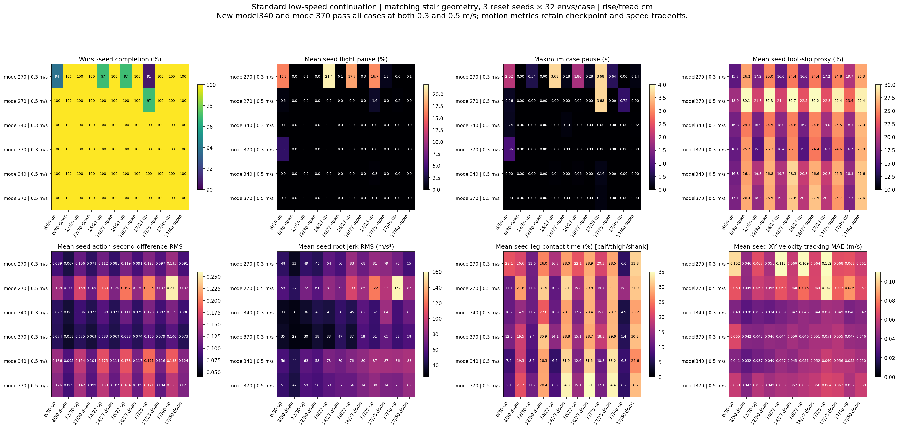

# Standard370 low-speed staircase validation

**Proceed to a separate moderate-hard simulation branch from model370, while retaining model340 as a distinct baseline.** Both new checkpoints complete every standard staircase trial at **both 0.3 and 0.5 m/s**. The previous low-speed rear-foot/short-tread stalls and faster first-step failures are absent in these batches. Model370 has lower action second-difference RMS than model340 in all 24 case/speed combinations, which supports the chosen continuation point while their contact and tracking tradeoffs remain visible.

## Traversal and matched conditions

Each new checkpoint completes **1152/1152 per speed**, or 2304/2304 across the two speeds: all twelve geometries, reset seeds 11/29/47, and 32 environments per case/seed. Every case/seed is 32/32; original 90% and final 95% traversal gates pass. Falls, stalls, lateral escapes, timeouts, nonfinite states, invalid physics, invalid starts and base-contact environments are all zero. There are no new failed positions to plot. An independent CPU check confirms every recorded successful endpoint has root x beyond its goal, all feet beyond the required last-riser/platform margins, and foot heights within the final-platform tolerance.

| Model / command m/s | Completed | Stalls | Worst case/seed | Final traversal | Max pause s |
|---|---:|---:|---:|---|---:|
| 270 / 0.3 | 1137/1152 | 15 | 0.90625 | FAIL | 3.68 |
| 270 / 0.5 | 1151/1152 | 1 | 0.96875 | PASS | 3.68 |
| 340 / 0.3 | 1152/1152 | 0 | 1.00000 | PASS | 0.24 |
| 370 / 0.3 | 1152/1152 | 0 | 1.00000 | PASS | 0.96 |
| 340 / 0.5 | 1152/1152 | 0 | 1.00000 | PASS | 0.16 |
| 370 / 0.5 | 1152/1152 | 0 | 1.00000 | PASS | 0.12 |

The new cases exactly match model270 geometry, reset seeds, heading control, both threshold sets, per-environment initial root-position arrays and aggregate initial pose-distribution records. The 0.3 m/s runs use 25 s duration budgets; the new 0.5 m/s runs use 24 s versus the old model270/0.5 run's 25 s. Every new episode completes before its budget with no timeout censoring. Per-environment initial quaternions were not stored, so this establishes matched roots and pose distributions rather than exact full initial states. All cases have six steps, 1.2 m width, no nosing, 2 m landings and heights 8–17 cm; tread depths are 25/27/30/40 cm as recorded. Dynamics are nominal. Material parameters/draws are not recorded and can differ across constructions; reset seeds do not independently resample startup dynamics/materials.

The continuation training configuration resumes `stairs-standard-faithful270/model_270.pt` and changes its speed range from **0.4–0.8 to 0.25–0.65 m/s**. Recorded algorithm/runner settings, robot timestep, reward weights including stair rewards, terrain variants, dynamics profile and 4096-environment count are identical. The continuation has no exploration-std override. This range comes from the training run's config; the evaluation config's default speed range is not evidence of training commands. Training continuation and speed-range adjustment explain the experiment design, without establishing that every unrecorded realization is identical.

## Motion comparison

Statistics below are arithmetic means of three seed-level aggregate metrics; the macro table then gives each of the twelve cases equal weight. These are descriptive means, not a pooled sample RMS or significance test. Motion metrics cover the first measured episode and exclude the first second. Stalled environments in the old run can lower action variation; the old and new runs also have different episode lengths due to traversal behavior.

| Model / speed | Case-macro pause % | Action second RMS | Root jerk RMS m/s³ | Leg contact % | Foot-slip proxy % | XY tracking MAE m/s |
|---|---:|---:|---:|---:|---:|---:|
| 270 / 0.3 | 6.14 | 0.0989 | 61.2 | 21.89 | 21.12 | 0.0768 |
| 270 / 0.5 | 0.20 | 0.1557 | 86.7 | 21.73 | 25.84 | 0.0695 |
| 340 / 0.3 | 0.01 | 0.0893 | 50.0 | 18.25 | 21.42 | 0.0410 |
| 370 / 0.3 | 0.33 | 0.0781 | 44.5 | 20.27 | 20.74 | 0.0488 |
| 340 / 0.5 | 0.03 | 0.1406 | 72.4 | 18.62 | 23.17 | 0.0471 |
| 370 / 0.5 | 0.01 | 0.1280 | 65.5 | 20.64 | 22.79 | 0.0552 |

At the same 0.3 m/s command, model370 has lower action second-difference RMS than model270 in every case. Root jerk is lower in eleven of twelve cases, with the exception of 17/40 cm descent (58.3 versus 54.9 m/s³). All old failing geometries now complete fully. Leg contact and the foot-slip proxy do not improve uniformly: for example, 12 cm descent leg contact rises from 26.04% to 30.86%, while 8 cm ascent foot-slip proxy is 16.06% versus 15.69%. These results support a traversal improvement and several motion improvements rather than claiming every metric improves.

Selected matched cases are shown below; the plot and JSON include all twelve at both speeds. Rise/tread dimensions are centimetres; compare checkpoints within the same commanded speed.

| Model / speed / rise-tread cm | Mean pause % | Max pause s | Action second RMS | Root jerk m/s³ | Leg contact % | Slip proxy % |
|---|---:|---:|---:|---:|---:|---:|
| 270 / 0.3 / 8/30 asc | 16.23 | 2.02 | 0.0886 | 48.4 | 22.08 | 15.69 |
| 270 / 0.5 / 8/30 asc | 0.58 | 0.26 | 0.1377 | 59.1 | 11.07 | 18.91 |
| 340 / 0.3 / 8/30 asc | 0.12 | 0.24 | 0.0767 | 32.6 | 10.73 | 16.85 |
| 370 / 0.3 / 8/30 asc | 3.94 | 0.96 | 0.0745 | 34.6 | 12.50 | 16.06 |
| 340 / 0.5 / 8/30 asc | 0.00 | 0.00 | 0.1359 | 56.5 | 7.44 | 16.78 |
| 370 / 0.5 / 8/30 asc | 0.00 | 0.00 | 0.1262 | 50.9 | 9.13 | 17.14 |
| 270 / 0.3 / 16/27 asc | 17.72 | 1.86 | 0.1191 | 83.0 | 22.08 | 16.63 |
| 270 / 0.5 / 16/27 asc | 0.00 | 0.02 | 0.1969 | 103.5 | 15.83 | 22.45 |
| 340 / 0.3 / 16/27 asc | 0.00 | 0.00 | 0.1111 | 45.0 | 12.69 | 16.81 |
| 370 / 0.3 / 16/27 asc | 0.00 | 0.00 | 0.0884 | 37.3 | 15.09 | 15.28 |
| 340 / 0.5 / 16/27 asc | 0.01 | 0.06 | 0.1778 | 75.6 | 12.64 | 20.82 |
| 370 / 0.5 / 16/27 asc | 0.00 | 0.00 | 0.1636 | 66.2 | 15.13 | 20.22 |
| 270 / 0.3 / 17/25 asc | 16.69 | 3.68 | 0.1218 | 81.5 | 20.29 | 17.18 |
| 270 / 0.5 / 17/25 asc | 1.65 | 3.68 | 0.2046 | 122.2 | 14.68 | 22.29 |
| 340 / 0.3 / 17/25 asc | 0.00 | 0.00 | 0.1198 | 51.5 | 15.84 | 18.99 |
| 370 / 0.3 / 17/25 asc | 0.00 | 0.00 | 0.1005 | 51.4 | 18.83 | 16.32 |
| 340 / 0.5 / 17/25 asc | 0.31 | 0.16 | 0.1910 | 87.3 | 10.82 | 20.79 |
| 370 / 0.5 / 17/25 asc | 0.07 | 0.12 | 0.1712 | 80.4 | 12.11 | 20.19 |
| 270 / 0.3 / 17/25 desc | 1.17 | 0.64 | 0.0970 | 79.2 | 28.49 | 24.77 |
| 270 / 0.5 / 17/25 desc | 0.00 | 0.00 | 0.1332 | 92.7 | 30.13 | 29.44 |
| 340 / 0.3 / 17/25 desc | 0.00 | 0.00 | 0.0874 | 84.2 | 29.69 | 25.50 |
| 370 / 0.3 / 17/25 desc | 0.00 | 0.00 | 0.0785 | 65.2 | 29.86 | 24.58 |
| 340 / 0.5 / 17/25 desc | 0.00 | 0.00 | 0.1158 | 86.9 | 32.96 | 26.54 |
| 370 / 0.5 / 17/25 desc | 0.00 | 0.00 | 0.1041 | 73.9 | 34.41 | 25.65 |
| 270 / 0.3 / 17/40 desc | 0.08 | 0.14 | 0.0905 | 54.9 | 31.79 | 26.25 |
| 270 / 0.5 / 17/40 desc | 0.00 | 0.00 | 0.1322 | 86.1 | 30.99 | 29.43 |
| 340 / 0.3 / 17/40 desc | 0.00 | 0.02 | 0.0863 | 68.0 | 28.18 | 26.97 |
| 370 / 0.3 / 17/40 desc | 0.00 | 0.00 | 0.0730 | 58.3 | 30.31 | 26.78 |
| 340 / 0.5 / 17/40 desc | 0.00 | 0.00 | 0.1242 | 88.4 | 26.55 | 27.64 |
| 370 / 0.5 / 17/40 desc | 0.00 | 0.00 | 0.1207 | 82.0 | 30.18 | 27.58 |

## Remaining weaknesses and checkpoint choice

Model370 still hesitates on the 8/30 cm ascent: mean flight pause is **3.94%**, and seed11 maximum pause is **0.960 s**, close to the 1 s motion-flag limit. Model340 has mean pause **0.12%** and maximum **0.240 s** on that case; it also has lower roll RMS (0.0268 versus 0.0537 rad), velocity tracking MAE (0.0402 versus 0.0653 m/s) and root jerk (32.6 versus 34.6 m/s³). Model370 reduces this case's discrete action second RMS (0.0745 versus 0.0767) and foot-slip proxy (16.06% versus 16.85%). There is no single scalar winner.

At 0.3 m/s, model370's action second-difference RMS is below model340 in **all twelve cases**, and root jerk is lower in eleven. On 17/25 cm descent, it reduces root jerk from 84.2 to 65.2 m/s³. In exchange, leg-contact time is higher than model340 in ten cases, including 12 cm descent (30.86% versus 22.81%). Downstairs at 0.3 m/s, model370 retains leg-contact fractions of 19.49–30.86% and foot-slip proxy fractions of 24.35–26.78%; these remain meaningful video-review targets. The 17/25 cm ascent has no pauses but still has the highest new-policy ascent pitch RMS (0.3133 rad), with 18.83% leg-contact time.

At 0.5 m/s, model370 has lower action second-difference RMS and root jerk than model340 in **all twelve cases**. Longest pause is 0.12 s versus model340's 0.16 s, both on 17/25 cm ascent; the 8 cm low-speed hesitation is absent. The short-tread ascent now completes 96/96 with only 0.074% mean pause. Higher speed still increases action variation/jerk within model370: 16 cm ascent action second RMS rises from 0.0884 to 0.1636 and root jerk from 37.3 to 66.2 m/s³. Model370/0.5 also has higher leg-contact fractions than model340/0.5 in eleven cases, and higher XY tracking MAE in eleven cases. Its 16 cm descent retains 36.10% leg-contact time and 27.47% foot-slip proxy. Complete traversal therefore retains contact and tracking costs.

`shank_contact_step_fraction` combines calf/thigh/shank and is not calf-only contact. The foot-slip metric uses foot-link horizontal velocity during recent normal-contact history above 1 N, so it is a proxy rather than exact contact-point tangential slip. Root jerk is an estimated physical root-motion metric; action second differences are discrete command variation. Both checkpoints have `motion_improvement_needed=False` because no pause exceeds the recorded flag threshold, but **`smoothness_verified=False` and `visual_review_required=True` remain**. These flags do not certify smoothness or remove the observed contact/slip concerns.

## Recommended next verification

Preserve model340 and model370 as baselines at both tested speeds. The moderate-hard continuation starts from model370 to retain its lower action variation and most higher-step jerk, with model340 kept for its smaller low-speed low-step hesitation and better tracking/contact in many cases. Increase geometric difficulty in a separate branch and retain these standard cases as regression tests; model370's successful standard results do not establish its future performance on 20 cm steps or nosing.

Harder geometry, nosing, independent material/dynamics changes and deployment remain separate validation conditions. The current result demonstrates complete traversal at the two tested command speeds within the stated fixed-dynamics, no-nosing simulation cases.

- `stair-standard370-comparison.json`: six evaluations, 72 case records, complete seed metrics, endpoint consistency checks, matching and training provenance; no new failures.
- `stair-standard370-matched-comparison.{png,pdf}`: all twelve cases, traversal, pause, action variation, jerk, leg contact, foot-slip proxy and tracking error.
- New raw evaluations: `isaaclab/logs/2026-10-11_03-04-27_standard370-low-speed-validation` and `isaaclab/logs/2026-10-11_03-08-49_standard370-speed05-validation`, including their model340 candidates. Generic evaluation exports are `stair-standard370-evaluation.{json,csv,md}`.
- Prior matched evidence: `stair-standard270-analysis.md` and `stair-standard270-comparison.json`. No GPU runs, evaluation reruns, threshold changes, source modifications or Git commits were made for this analysis.
