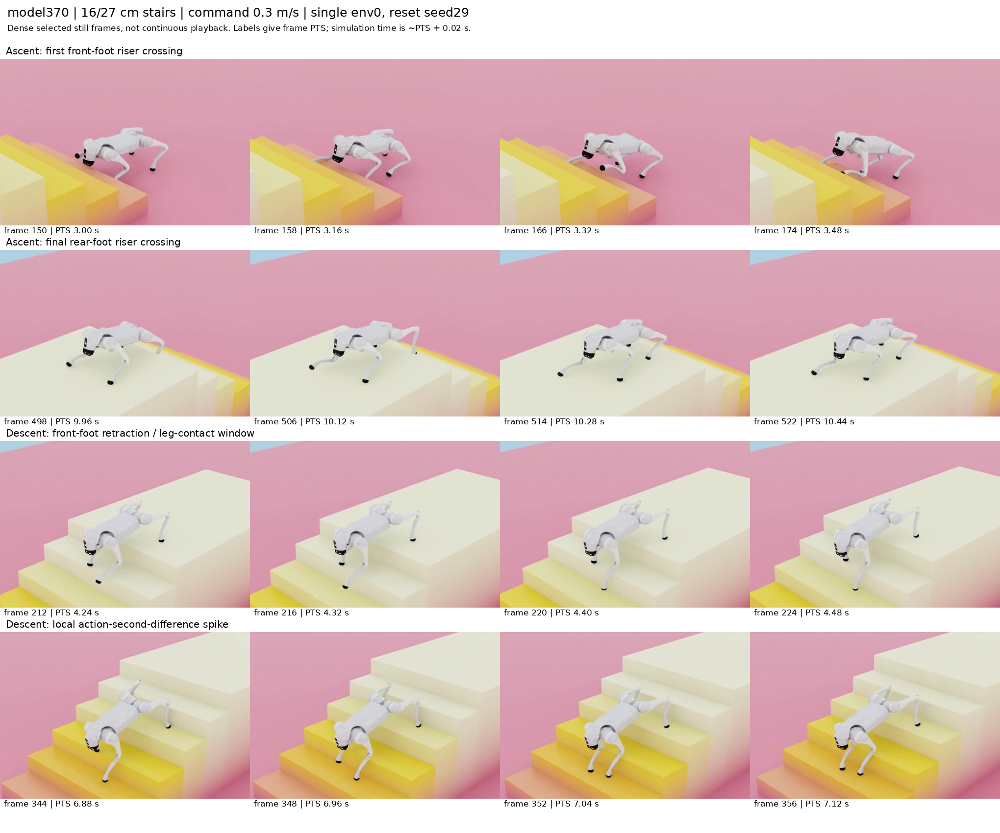
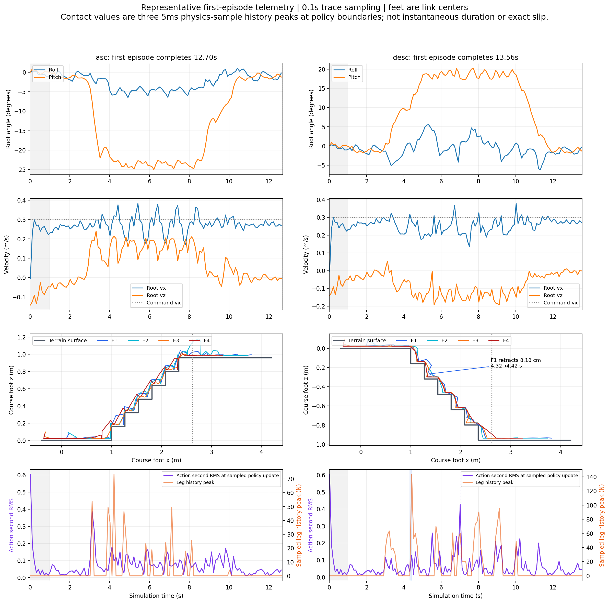

# Standard370 16 cm sampled-video and foot-trajectory review

The sampled frames and first-episode telemetry support complete, consistently forward traversal of six 16 cm steps in both directions at a 0.3 m/s command. The robot remains upright in the inspected frames, with regular leg flexion and terrain-following pitch; no persistent pause, fall or belly support is evident. Brief descending foot correction and action/contact peaks remain, so this review **does not certify smooth motion or exclude brief stumbling between samples**.

The review inspected the original six-frame sheet for each direction, sixteen additional stills around selected transitions, and each recording's actual final frame. It did not watch continuous video playback. Telemetry is sampled every 0.1 s; camera frames are 50 fps. Both recordings represent one environment, env0, reset seed29, nominal dynamics, 16 cm rise/27 cm tread and no nosing. They supplement the broader three-seed validation rather than replacing its counts.

## First-episode boundaries

Both runs set `video_policy_only=True` and `evaluation_include_zero_action=False`. Each contains one environment and one trial, and finishes when that environment completes. There is no later negative-control reset, completed-env wait for another robot, or subsequent trial. All trace samples remain in the active first episode.

| Direction | Frames / fps | Frame PTS | First-episode completion | Actual final root x | Minimum final foot x |
|---|---|---|---:|---:|---:|
| Ascent | 635 / 50 | 0–12.68 s | 12.70 s | 3.402834 m | 3.101571 m |
| Descent | 678 / 50 | 0–13.54 s | 13.56 s | 3.405162 m | 3.101573 m |

Capture occurs after each 0.02 s policy step, so simulation time is approximately frame PTS + 0.02 s. Both final frames show the destination landing. Root goal x is 3.27 m and final-platform start is 2.62 m. Final foot-link centers are z≈0.983–0.984 m above the +0.96 m ascent platform and z≈−0.937 to −0.936 m above the −0.96 m descent platform. These are actual saved terminal states before reset; the last trace samples are slightly earlier, at 12.62/13.52 s.

## Gait and terrain transitions

Root x increases strictly across recorded flight samples. Ascent root vx ranges 0.170–0.383 m/s and descent 0.134–0.378 m/s; both runs report zero flight-pause fraction and zero longest pause. Root roll stays within −6.50° to +0.70° on ascent and −4.20° to +5.56° on descent while root x is between first riser and final-platform start. Pitch is −24.99° to −8.43° on ascent and +9.26° to +20.27° on descent, consistent with leaning along the stair grade. The geometric mean grade is about 30.7°; it is a reference, not a commanded body angle. Both return toward level posture on the final landing.

Four indexed foot trajectories progress through successive treads. F1/F2 are front-positioned and F3/F4 rear-positioned in stored order; body names are not saved in evaluation JSON. First recorded crossings of x=1.03 m occur at 3.32/3.12/4.82/4.32 s for ascent and 3.22/2.82/5.52/5.92 s for descent. Rear feet pass x=2.38 m beyond the final riser at 10.22/9.82 s on ascent and 11.12/11.42 s on descent, then all reach the final platform. These are 0.1 s sampled crossing times and foot-center paths, not exact touchdown times or toe-clearance measurements.

Ascent trajectories show repeated forward swings and step-height increases without the previous final-riser rear-foot stall. During root-flight samples, rearward per-foot x changes are at most about 8.7 mm between adjacent samples. The denser first-step and final-rear-step stills show leg lifting and advancing while the body stays supported. This supports successful consistent traversal in the representative recording, without proving a particular gait classification or uniform swing clearance.

## Local corrections and impact evidence

Descent contains a visible trajectory correction: F1 x retracts **8.18 cm**, from 1.414742 to 1.332893 m between simulation 4.32 and 4.42 s while dropping toward the second lower tread. A sampled aggregate leg-history peak reaches **143.4 N** at 4.42 s. The selected 4.24–4.48 s PTS stills show a supported robot with the front leg flexing through the transition; no overturn or sustained halt appears. The paired trace supports a transient foot/leg correction near the step, but cannot identify which calf/thigh/shank body produced the force or distinguish the exact collision mechanism.

A second local event occurs at 7.02 s: sampled action second-difference RMS reaches **0.426**, with leg-history peak 59.8 N and root vx≈0.199 m/s. The selected surrounding frames remain upright and advancing. Ascent also has a first-riser action spike: post-first-second sampled maximum is **0.387 at 3.12 s**; maximum within root-flight samples is 0.180. These discrete action peaks show that traversal is not free of local corrections. The high action value at the first recorded sample belongs to initialization and is excluded from the evaluator's motion statistics; it should not be treated as a staircase impact.

Recorded first-episode motion statistics, excluding the first second, give physical jerk RMS of 36.0 m/s³ ascent and 50.7 m/s³ descent, and action second-difference RMS is 0.0879/0.0744. Recorded overall peak contact force is 134.9/408.6 N, distinct from the lower sampled leg-only history peaks above. A sparse trace can miss larger forces or action changes between samples. All recorded base-force samples are zero, and the evaluator reports zero base-contact environments, falls, stalls, escapes, timeouts or invalid physics. This gives no positive evidence of a major instability in the recorded episodes, but does not establish absence of every short scrape or stumble.

## Contact and slip metric interpretation

The pinned framework's `BaseContactSensor.update` explicitly updates history-bearing buffers each physics step even with lazy sensor updates. The PhysX environment calls `scene.update` every **5 ms**, and the three-sample history at a policy boundary contains **T, T−5 ms, T−10 ms**. The oldest sample age is 10 ms; three samples give a nominal count window of 15 ms. This history does not retain a force present only in the first substep T−15 ms of every 20 ms policy interval. The generic assumption that lazy updates make this history 20/40 ms is incorrect for this implementation.

The legacy leg fraction is the proportion of policy boundaries where any calf/thigh/shank body's three-sample normal-force-norm history peak exceeds 1 N. It is **a short-history contact-existence proxy, not sustained scraping duration or calf-only contact time**. The saved one-env values are 15.38% ascent and 25.00% descent. The foot-slip proxy pairs that recent-contact gate with current world-XY foot-link speed; early swing after contact can enter the score. The saved 15.27%/24.65% values are not exact contact-point tangential slip. These semantics qualify the scores without invalidating the confirmed physics-step history cadence.

Verified sources are `base_contact_sensor.py:65`, `manager_based_rl_env.py:229`, and PhysX `contact_sensor/kernels.py:283` in the local pinned IsaacLab checkout. The JSON records their full paths, metric scope and window definitions. This review uses the recorded legacy metrics and does not rerun or change simulation.

## Artifacts

- `stair-standard370-video-review.json`: boundaries, inspected frame IDs, terminal states, root ranges, foot passages, local events and sensor provenance.
- `stair-standard370-video-dense-phases.png`: sixteen denser selected transition stills; no continuous-playback claim.
- `stair-standard370-video-foot-trajectories.{png,pdf}`: active first-episode root angles/velocities, foot-center paths, sampled action variation and aggregate leg-history force.
- Raw recordings: `isaaclab/logs/2026-10-11_03-10-39_standard370-16cm-asc-speed03-video/videos/go2_stairs_asc_0000.mp4` and `isaaclab/logs/2026-10-11_03-11-42_standard370-16cm-desc-speed03-video/videos/go2_stairs_desc_0000.mp4`.

No GPU runs, source modifications, driver changes or Git commits were made for this review.
